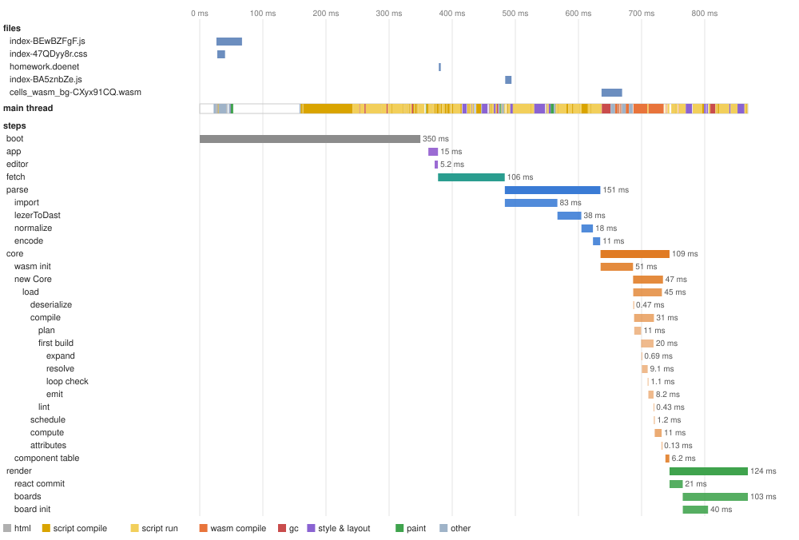
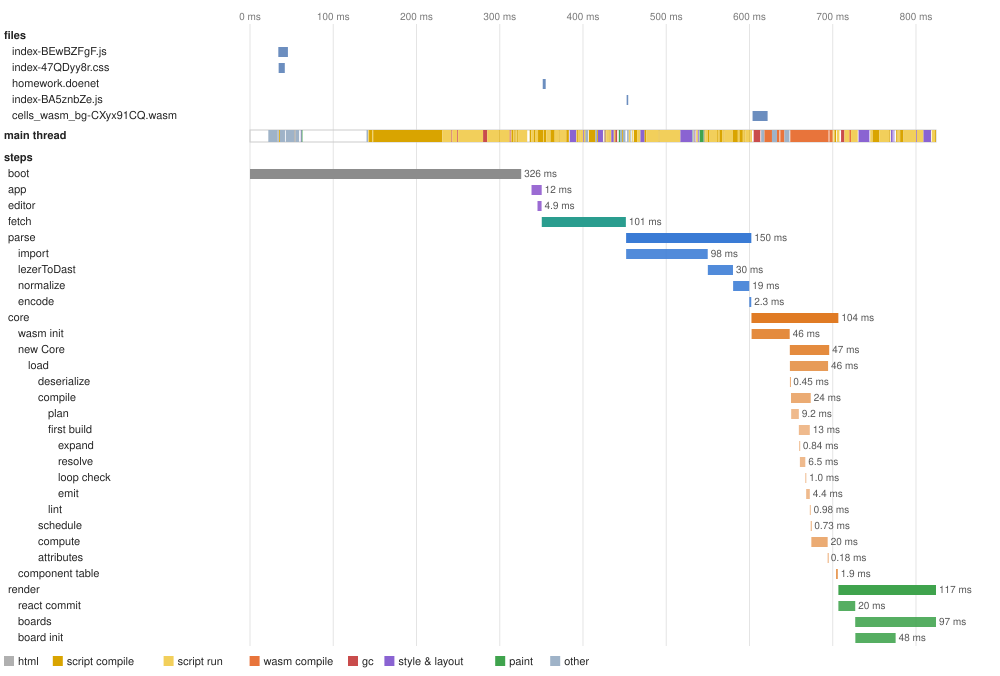
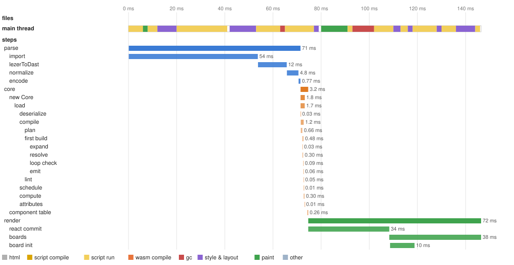

# Load trace: 2026-10-19-claude-cloud-57c94fadf

Machine **claude-cloud** (Intel(R) Xeon(R) Processor @ 2.80GHz, 4 cores, 16093 MB, Linux 6.18.44-fc-v139 x64, Node v22.22.0); commit `57c94fadf`; 2026-10-19.

Builds: cells: wasm-pack --release (npm run build -w packages/cells-core).

What the cells viewer does to get from DoenetML text to the first render, step by step, in the order it does it, and what the browser does underneath. Each scenario loads the page by navigation from the viewer's build, served as a host would serve it, and ends at the first render (the `render` step's end). Step times are medians of 5 runs. The figures are of one more run made under a Chrome performance trace, which slows the page somewhat, so their times run a little above the tables'. A step's name is its path: `parse/lezerToDast` is part of `parse`. What every step does, and where its code is, is under [Steps](#steps). How the layer works: [METHOD.md](../../../METHOD.md#the-trace-layer).

## First render

Navigation (or, for `edit`, the Refresh) to the first render, median; under it the fastest and slowest run.

| Scenario (homework) | CPU ×1 | CPU ×4 |
|---|---|---|
| editor page, cold | **853 ms** 787 ms–1.09 s | **3.09 s** 2.86 s–3.51 s |
| editor page, warm | **824 ms** 791 ms–1.18 s | **3.09 s** 2.87 s–3.23 s |
| editor page, hot | **811 ms** 722 ms–882 ms | **3.17 s** 3.07 s–3.33 s |
| editor page, edit | **144 ms** 130 ms–202 ms | **614 ms** 510 ms–706 ms |
| viewer page, cold | **548 ms** 536 ms–590 ms | **2.11 s** 2.03 s–2.35 s |
| viewer page, warm | **526 ms** 505 ms–571 ms | **1.99 s** 1.92 s–2.14 s |
| viewer page, hot | **542 ms** 507 ms–550 ms | **2.14 s** 2.03 s–2.19 s |
| viewer page, edit | **57 ms** 52 ms–59 ms | **272 ms** 229 ms–279 ms |

- **cold**: a first visit: a new browser profile, nothing cached.
- **warm**: a second visit: the files in the HTTP cache; Chromium caches compiled code for the larger scripts during this visit.
- **hot**: a third visit: the first that could use that compiled code (whether it did shows in script compile, under The main thread by kind of work).
- **edit**: the open page given a changed document, as the editor's Refresh does.

## editor page, cold, CPU ×1

A first visit: a new browser profile, nothing cached. First render **853 ms**.

The traced run: first render 868 ms. Top: the files the page fetched (from the cache when the tooltip says so). Middle: what the main thread did, by kind. Bottom: the steps. Hover a bar for its numbers.

| Step | Starts at | Takes | Work |
|---|---|---|---|
| boot | 0.00 ms | 310 ms |  |
| app | 319 ms | 12 ms |  |
| editor | 324 ms | 4.9 ms |  |
| fetch | 332 ms | 115 ms | 3,922 chars |
| parse | 443 ms | 171 ms | 3,922 chars |
| &nbsp;&nbsp;import | 443 ms | 110 ms |  |
| &nbsp;&nbsp;lezerToDast | 566 ms | 46 ms | 3,922 chars |
| &nbsp;&nbsp;normalize | 606 ms | 8.2 ms |  |
| &nbsp;&nbsp;encode | 615 ms | 1.7 ms |  |
| core | 617 ms | 111 ms |  |
| &nbsp;&nbsp;wasm init | 617 ms | 53 ms |  |
| &nbsp;&nbsp;new Core | 701 ms | 49 ms | 12,920 bytes |
| &nbsp;&nbsp;&nbsp;&nbsp;load | 701 ms | 48 ms |  |
| &nbsp;&nbsp;&nbsp;&nbsp;&nbsp;&nbsp;deserialize | 701 ms | 0.29 ms | 12,920 bytes, 379 dast nodes |
| &nbsp;&nbsp;&nbsp;&nbsp;&nbsp;&nbsp;compile | 702 ms | 29 ms |  |
| &nbsp;&nbsp;&nbsp;&nbsp;&nbsp;&nbsp;&nbsp;&nbsp;plan | 702 ms | 11 ms | 122 elements, 2 templates |
| &nbsp;&nbsp;&nbsp;&nbsp;&nbsp;&nbsp;&nbsp;&nbsp;first build | 713 ms | 17 ms |  |
| &nbsp;&nbsp;&nbsp;&nbsp;&nbsp;&nbsp;&nbsp;&nbsp;&nbsp;&nbsp;expand | 713 ms | 0.85 ms |  |
| &nbsp;&nbsp;&nbsp;&nbsp;&nbsp;&nbsp;&nbsp;&nbsp;&nbsp;&nbsp;resolve | 714 ms | 8.9 ms |  |
| &nbsp;&nbsp;&nbsp;&nbsp;&nbsp;&nbsp;&nbsp;&nbsp;&nbsp;&nbsp;loop check | 724 ms | 1.2 ms |  |
| &nbsp;&nbsp;&nbsp;&nbsp;&nbsp;&nbsp;&nbsp;&nbsp;&nbsp;&nbsp;emit | 725 ms | 4.3 ms | 467 cells, 124 components, 95 instructions |
| &nbsp;&nbsp;&nbsp;&nbsp;&nbsp;&nbsp;&nbsp;&nbsp;lint | 730 ms | 0.45 ms |  |
| &nbsp;&nbsp;&nbsp;&nbsp;&nbsp;&nbsp;schedule | 730 ms | 0.92 ms | 95 instructions |
| &nbsp;&nbsp;&nbsp;&nbsp;&nbsp;&nbsp;compute | 732 ms | 14 ms | 467 cells |
| &nbsp;&nbsp;&nbsp;&nbsp;&nbsp;&nbsp;attributes | 749 ms | 0.30 ms |  |
| &nbsp;&nbsp;component table | 756 ms | 1.9 ms | 124 components |
| render | 758 ms | 100 ms | 124 components, 1,615 elements |
| &nbsp;&nbsp;react commit | 758 ms | 22 ms | 124 components |
| &nbsp;&nbsp;boards | 778 ms | 76 ms | 1 boards |
| &nbsp;&nbsp;board init | 778 ms | 30 ms |  |

The main thread in the traced run, by kind of work (other threads' work is not counted; see below):

| Kind | Time | Share | What it is |
|---|---|---|---|
| html | 5.4 ms | 1% | parsing the HTML |
| script compile | 193 ms | 22% | V8 parsing and compiling JavaScript (including lazy compiles of functions on their first call) |
| script run | 309 ms | 36% | running JavaScript: the page's code, React, the parser, JSXGraph |
| wasm compile | 58 ms | 7% | compiling WebAssembly (eager validation, and lazy compiles of functions on their first call) |
| gc | 32 ms | 4% | garbage collection |
| style & layout | 73 ms | 8% | computing styles and laying out the page |
| paint | 13 ms | 1% | painting and handing the frame to the compositor |
| other | 54 ms | 6% | the browser's own task handling and work of no kind above (loading, messages) |
| idle | 131 ms | 15% | waiting: for the network, a timer or the next frame |

## editor page, warm, CPU ×1

A second visit: the files in the HTTP cache; Chromium caches compiled code for the larger scripts during this visit. First render **824 ms**.

The traced run: first render 913 ms. Top: the files the page fetched (from the cache when the tooltip says so). Middle: what the main thread did, by kind. Bottom: the steps. Hover a bar for its numbers.

| Step | Starts at | Takes | Work |
|---|---|---|---|
| boot | 0.00 ms | 300 ms |  |
| app | 311 ms | 12 ms |  |
| editor | 318 ms | 5.2 ms |  |
| fetch | 324 ms | 115 ms | 3,922 chars |
| parse | 444 ms | 171 ms | 3,922 chars |
| &nbsp;&nbsp;import | 444 ms | 113 ms |  |
| &nbsp;&nbsp;lezerToDast | 560 ms | 40 ms | 3,922 chars |
| &nbsp;&nbsp;normalize | 592 ms | 8.3 ms |  |
| &nbsp;&nbsp;encode | 600 ms | 1.5 ms |  |
| core | 603 ms | 101 ms |  |
| &nbsp;&nbsp;wasm init | 603 ms | 45 ms |  |
| &nbsp;&nbsp;new Core | 651 ms | 48 ms | 12,920 bytes |
| &nbsp;&nbsp;&nbsp;&nbsp;load | 651 ms | 47 ms |  |
| &nbsp;&nbsp;&nbsp;&nbsp;&nbsp;&nbsp;deserialize | 651 ms | 0.32 ms | 12,920 bytes, 379 dast nodes |
| &nbsp;&nbsp;&nbsp;&nbsp;&nbsp;&nbsp;compile | 652 ms | 29 ms |  |
| &nbsp;&nbsp;&nbsp;&nbsp;&nbsp;&nbsp;&nbsp;&nbsp;plan | 652 ms | 11 ms | 122 elements, 2 templates |
| &nbsp;&nbsp;&nbsp;&nbsp;&nbsp;&nbsp;&nbsp;&nbsp;first build | 664 ms | 13 ms |  |
| &nbsp;&nbsp;&nbsp;&nbsp;&nbsp;&nbsp;&nbsp;&nbsp;&nbsp;&nbsp;expand | 664 ms | 0.78 ms |  |
| &nbsp;&nbsp;&nbsp;&nbsp;&nbsp;&nbsp;&nbsp;&nbsp;&nbsp;&nbsp;resolve | 665 ms | 6.5 ms |  |
| &nbsp;&nbsp;&nbsp;&nbsp;&nbsp;&nbsp;&nbsp;&nbsp;&nbsp;&nbsp;loop check | 675 ms | 1.3 ms |  |
| &nbsp;&nbsp;&nbsp;&nbsp;&nbsp;&nbsp;&nbsp;&nbsp;&nbsp;&nbsp;emit | 676 ms | 3.0 ms | 467 cells, 124 components, 95 instructions |
| &nbsp;&nbsp;&nbsp;&nbsp;&nbsp;&nbsp;&nbsp;&nbsp;lint | 679 ms | 0.41 ms |  |
| &nbsp;&nbsp;&nbsp;&nbsp;&nbsp;&nbsp;schedule | 681 ms | 1.9 ms | 95 instructions |
| &nbsp;&nbsp;&nbsp;&nbsp;&nbsp;&nbsp;compute | 683 ms | 15 ms | 467 cells |
| &nbsp;&nbsp;&nbsp;&nbsp;&nbsp;&nbsp;attributes | 696 ms | 0.16 ms |  |
| &nbsp;&nbsp;component table | 702 ms | 1.9 ms | 124 components |
| render | 704 ms | 99 ms | 124 components, 1,625 elements |
| &nbsp;&nbsp;react commit | 704 ms | 26 ms | 124 components |
| &nbsp;&nbsp;boards | 727 ms | 72 ms | 1 boards |
| &nbsp;&nbsp;board init | 727 ms | 28 ms |  |

The main thread in the traced run, by kind of work (other threads' work is not counted; see below):

| Kind | Time | Share | What it is |
|---|---|---|---|
| html | 4.9 ms | 1% | parsing the HTML |
| script compile | 203 ms | 22% | V8 parsing and compiling JavaScript (including lazy compiles of functions on their first call) |
| script run | 349 ms | 38% | running JavaScript: the page's code, React, the parser, JSXGraph |
| wasm compile | 77 ms | 8% | compiling WebAssembly (eager validation, and lazy compiles of functions on their first call) |
| gc | 23 ms | 3% | garbage collection |
| style & layout | 71 ms | 8% | computing styles and laying out the page |
| paint | 16 ms | 2% | painting and handing the frame to the compositor |
| other | 61 ms | 7% | the browser's own task handling and work of no kind above (loading, messages) |
| idle | 108 ms | 12% | waiting: for the network, a timer or the next frame |

## editor page, hot, CPU ×1

A third visit: the first that could use that compiled code (whether it did shows in script compile, under The main thread by kind of work). First render **811 ms**.

The traced run: first render 824 ms. Top: the files the page fetched (from the cache when the tooltip says so). Middle: what the main thread did, by kind. Bottom: the steps. Hover a bar for its numbers.

| Step | Starts at | Takes | Work |
|---|---|---|---|
| boot | 0.00 ms | 313 ms |  |
| app | 320 ms | 11 ms |  |
| editor | 326 ms | 5.1 ms |  |
| fetch | 332 ms | 101 ms | 3,922 chars |
| parse | 427 ms | 143 ms | 3,922 chars |
| &nbsp;&nbsp;import | 427 ms | 101 ms |  |
| &nbsp;&nbsp;lezerToDast | 537 ms | 37 ms | 3,922 chars |
| &nbsp;&nbsp;normalize | 574 ms | 12 ms |  |
| &nbsp;&nbsp;encode | 590 ms | 1.6 ms |  |
| core | 593 ms | 109 ms |  |
| &nbsp;&nbsp;wasm init | 593 ms | 57 ms |  |
| &nbsp;&nbsp;new Core | 646 ms | 44 ms | 12,920 bytes |
| &nbsp;&nbsp;&nbsp;&nbsp;load | 646 ms | 41 ms |  |
| &nbsp;&nbsp;&nbsp;&nbsp;&nbsp;&nbsp;deserialize | 646 ms | 0.34 ms | 12,920 bytes, 379 dast nodes |
| &nbsp;&nbsp;&nbsp;&nbsp;&nbsp;&nbsp;compile | 647 ms | 25 ms |  |
| &nbsp;&nbsp;&nbsp;&nbsp;&nbsp;&nbsp;&nbsp;&nbsp;plan | 647 ms | 11 ms | 122 elements, 2 templates |
| &nbsp;&nbsp;&nbsp;&nbsp;&nbsp;&nbsp;&nbsp;&nbsp;first build | 656 ms | 13 ms |  |
| &nbsp;&nbsp;&nbsp;&nbsp;&nbsp;&nbsp;&nbsp;&nbsp;&nbsp;&nbsp;expand | 656 ms | 0.58 ms |  |
| &nbsp;&nbsp;&nbsp;&nbsp;&nbsp;&nbsp;&nbsp;&nbsp;&nbsp;&nbsp;resolve | 657 ms | 7.1 ms |  |
| &nbsp;&nbsp;&nbsp;&nbsp;&nbsp;&nbsp;&nbsp;&nbsp;&nbsp;&nbsp;loop check | 664 ms | 0.86 ms |  |
| &nbsp;&nbsp;&nbsp;&nbsp;&nbsp;&nbsp;&nbsp;&nbsp;&nbsp;&nbsp;emit | 666 ms | 4.8 ms | 467 cells, 124 components, 95 instructions |
| &nbsp;&nbsp;&nbsp;&nbsp;&nbsp;&nbsp;&nbsp;&nbsp;lint | 673 ms | 0.48 ms |  |
| &nbsp;&nbsp;&nbsp;&nbsp;&nbsp;&nbsp;schedule | 674 ms | 0.87 ms | 95 instructions |
| &nbsp;&nbsp;&nbsp;&nbsp;&nbsp;&nbsp;compute | 675 ms | 11 ms | 467 cells |
| &nbsp;&nbsp;&nbsp;&nbsp;&nbsp;&nbsp;attributes | 686 ms | 0.15 ms |  |
| &nbsp;&nbsp;component table | 693 ms | 1.7 ms | 124 components |
| render | 696 ms | 106 ms | 124 components, 1,625 elements |
| &nbsp;&nbsp;react commit | 696 ms | 24 ms | 124 components |
| &nbsp;&nbsp;boards | 725 ms | 76 ms | 1 boards |
| &nbsp;&nbsp;board init | 725 ms | 34 ms |  |

The main thread in the traced run, by kind of work (other threads' work is not counted; see below):

| Kind | Time | Share | What it is |
|---|---|---|---|
| html | 4.4 ms | 1% | parsing the HTML |
| script compile | 205 ms | 25% | V8 parsing and compiling JavaScript (including lazy compiles of functions on their first call) |
| script run | 275 ms | 33% | running JavaScript: the page's code, React, the parser, JSXGraph |
| wasm compile | 64 ms | 8% | compiling WebAssembly (eager validation, and lazy compiles of functions on their first call) |
| gc | 23 ms | 3% | garbage collection |
| style & layout | 71 ms | 9% | computing styles and laying out the page |
| paint | 9.1 ms | 1% | painting and handing the frame to the compositor |
| other | 68 ms | 8% | the browser's own task handling and work of no kind above (loading, messages) |
| idle | 104 ms | 13% | waiting: for the network, a timer or the next frame |

## editor page, edit, CPU ×1

The open page given a changed document, as the editor's Refresh does. First render **144 ms**.

The traced run: first render 146 ms. Top: the files the page fetched (from the cache when the tooltip says so). Middle: what the main thread did, by kind. Bottom: the steps. Hover a bar for its numbers.

| Step | Starts at | Takes | Work |
|---|---|---|---|
| parse | 0.09 ms | 76 ms | 3,938 chars |
| &nbsp;&nbsp;import | 0.09 ms | 58 ms |  |
| &nbsp;&nbsp;lezerToDast | 59 ms | 11 ms | 3,938 chars |
| &nbsp;&nbsp;normalize | 70 ms | 2.4 ms |  |
| &nbsp;&nbsp;encode | 75 ms | 0.81 ms |  |
| core | 76 ms | 3.7 ms |  |
| &nbsp;&nbsp;new Core | 76 ms | 1.8 ms | 13,004 bytes |
| &nbsp;&nbsp;&nbsp;&nbsp;load | 76 ms | 1.8 ms |  |
| &nbsp;&nbsp;&nbsp;&nbsp;&nbsp;&nbsp;deserialize | 76 ms | 0.03 ms | 13,004 bytes, 382 dast nodes |
| &nbsp;&nbsp;&nbsp;&nbsp;&nbsp;&nbsp;compile | 76 ms | 1.2 ms |  |
| &nbsp;&nbsp;&nbsp;&nbsp;&nbsp;&nbsp;&nbsp;&nbsp;plan | 76 ms | 0.64 ms | 123 elements, 2 templates |
| &nbsp;&nbsp;&nbsp;&nbsp;&nbsp;&nbsp;&nbsp;&nbsp;first build | 77 ms | 0.53 ms |  |
| &nbsp;&nbsp;&nbsp;&nbsp;&nbsp;&nbsp;&nbsp;&nbsp;&nbsp;&nbsp;expand | 77 ms | 0.03 ms |  |
| &nbsp;&nbsp;&nbsp;&nbsp;&nbsp;&nbsp;&nbsp;&nbsp;&nbsp;&nbsp;resolve | 77 ms | 0.31 ms |  |
| &nbsp;&nbsp;&nbsp;&nbsp;&nbsp;&nbsp;&nbsp;&nbsp;&nbsp;&nbsp;loop check | 77 ms | 0.12 ms |  |
| &nbsp;&nbsp;&nbsp;&nbsp;&nbsp;&nbsp;&nbsp;&nbsp;&nbsp;&nbsp;emit | 77 ms | 0.07 ms | 467 cells, 125 components, 95 instructions |
| &nbsp;&nbsp;&nbsp;&nbsp;&nbsp;&nbsp;&nbsp;&nbsp;lint | 77 ms | 0.05 ms |  |
| &nbsp;&nbsp;&nbsp;&nbsp;&nbsp;&nbsp;schedule | 77 ms | 0.02 ms | 95 instructions |
| &nbsp;&nbsp;&nbsp;&nbsp;&nbsp;&nbsp;compute | 77 ms | 0.25 ms | 467 cells |
| &nbsp;&nbsp;&nbsp;&nbsp;&nbsp;&nbsp;attributes | 78 ms | 0.01 ms |  |
| &nbsp;&nbsp;component table | 79 ms | 0.27 ms | 125 components |
| render | 80 ms | 68 ms | 125 components, 1,642 elements |
| &nbsp;&nbsp;react commit | 80 ms | 23 ms | 125 components |
| &nbsp;&nbsp;boards | 105 ms | 44 ms | 1 boards |
| &nbsp;&nbsp;board init | 105 ms | 8.9 ms |  |

The main thread in the traced run, by kind of work (other threads' work is not counted; see below):

| Kind | Time | Share | What it is |
|---|---|---|---|
| html | 0.08 ms | 0% | parsing the HTML |
| script compile | 4.4 ms | 3% | V8 parsing and compiling JavaScript (including lazy compiles of functions on their first call) |
| script run | 78 ms | 53% | running JavaScript: the page's code, React, the parser, JSXGraph |
| wasm compile | 0.18 ms | 0% | compiling WebAssembly (eager validation, and lazy compiles of functions on their first call) |
| gc | 12 ms | 8% | garbage collection |
| style & layout | 38 ms | 26% | computing styles and laying out the page |
| paint | 12 ms | 8% | painting and handing the frame to the compositor |
| other | 1.4 ms | 1% | the browser's own task handling and work of no kind above (loading, messages) |
| idle | 0.18 ms | 0% | waiting: for the network, a timer or the next frame |

## Visits compared: editor page, CPU ×1

The same document on each visit. A step that shrinks from cold to hot was paying for something the browser caches (files, compiled code); one that does not is work done on every load. A step can also take longer only because the main thread was busy with something else when it was due: compare the main-thread lanes in the figures above.

| Step | cold | warm | hot | edit |
|---|---|---|---|---|
| boot | 310 ms | 300 ms | 313 ms | 0.00 ms |
| app | 12 ms | 12 ms | 11 ms | 0.00 ms |
| editor | 4.9 ms | 5.2 ms | 5.1 ms | 0.00 ms |
| fetch | 115 ms | 115 ms | 101 ms | 0.00 ms |
| parse | 171 ms | 171 ms | 143 ms | 76 ms |
| &nbsp;&nbsp;import | 110 ms | 113 ms | 101 ms | 58 ms |
| &nbsp;&nbsp;lezerToDast | 46 ms | 40 ms | 37 ms | 11 ms |
| &nbsp;&nbsp;normalize | 8.2 ms | 8.3 ms | 12 ms | 2.4 ms |
| &nbsp;&nbsp;encode | 1.7 ms | 1.5 ms | 1.6 ms | 0.81 ms |
| core | 111 ms | 101 ms | 109 ms | 3.7 ms |
| &nbsp;&nbsp;wasm init | 53 ms | 45 ms | 57 ms | 0.00 ms |
| &nbsp;&nbsp;new Core | 49 ms | 48 ms | 44 ms | 1.8 ms |
| &nbsp;&nbsp;component table | 1.9 ms | 1.9 ms | 1.7 ms | 0.27 ms |
| render | 100 ms | 99 ms | 106 ms | 68 ms |
| &nbsp;&nbsp;react commit | 22 ms | 26 ms | 24 ms | 23 ms |
| &nbsp;&nbsp;boards | 76 ms | 72 ms | 76 ms | 44 ms |
| &nbsp;&nbsp;board init | 30 ms | 28 ms | 34 ms | 8.9 ms |
| **first render** | **853 ms** | **824 ms** | **811 ms** | **144 ms** |

## The editor page and the viewer alone, cold, CPU ×1

Both load the same bundle; the viewer alone (`?editor=0`) does not mount the editor. The difference is what mounting the editor costs a load.

| Step | editor | viewer |
|---|---|---|
| boot | 310 ms | 299 ms |
| app | 12 ms | 6.3 ms |
| editor | 4.9 ms | 0.00 ms |
| fetch | 115 ms | 22 ms |
| parse | 171 ms | 47 ms |
| &nbsp;&nbsp;import | 110 ms | 15 ms |
| &nbsp;&nbsp;lezerToDast | 46 ms | 25 ms |
| &nbsp;&nbsp;normalize | 8.2 ms | 7.1 ms |
| &nbsp;&nbsp;encode | 1.7 ms | 1.4 ms |
| core | 111 ms | 87 ms |
| &nbsp;&nbsp;wasm init | 53 ms | 33 ms |
| &nbsp;&nbsp;new Core | 49 ms | 46 ms |
| &nbsp;&nbsp;component table | 1.9 ms | 2.0 ms |
| render | 100 ms | 76 ms |
| &nbsp;&nbsp;react commit | 22 ms | 19 ms |
| &nbsp;&nbsp;boards | 76 ms | 57 ms |
| &nbsp;&nbsp;board init | 30 ms | 27 ms |
| **first render** | **853 ms** | **548 ms** |

## A slower device: editor page, cold

Chromium's CPU throttling slows the page's threads by the factor named, standing in for a slower device. The network is not slowed.

| Step | CPU ×1 | CPU ×4 |
|---|---|---|
| boot | 310 ms | 1.06 s |
| app | 12 ms | 68 ms |
| editor | 4.9 ms | 29 ms |
| fetch | 115 ms | 465 ms |
| parse | 171 ms | 368 ms |
| &nbsp;&nbsp;import | 110 ms | 219 ms |
| &nbsp;&nbsp;lezerToDast | 46 ms | 87 ms |
| &nbsp;&nbsp;normalize | 8.2 ms | 38 ms |
| &nbsp;&nbsp;encode | 1.7 ms | 9.5 ms |
| core | 111 ms | 586 ms |
| &nbsp;&nbsp;wasm init | 53 ms | 322 ms |
| &nbsp;&nbsp;new Core | 49 ms | 189 ms |
| &nbsp;&nbsp;component table | 1.9 ms | 8.8 ms |
| render | 100 ms | 645 ms |
| &nbsp;&nbsp;react commit | 22 ms | 139 ms |
| &nbsp;&nbsp;boards | 76 ms | 407 ms |
| &nbsp;&nbsp;board init | 30 ms | 161 ms |
| **first render** | **853 ms** | **3.09 s** |

## The document's size: editor page, cold, CPU ×1

`homework-x<n>` is the homework page repeated in n sections. The last column is how much the step grew from ×1 to ×16: near 1 is a fixed cost of the page, near 16 is work proportional to the document.

| Step | ×1 | ×4 | ×16 | growth |
|---|---|---|---|---|
| boot | 310 ms | 337 ms | 315 ms | 1.0× |
| app | 12 ms | 12 ms | 11 ms | 0.9× |
| editor | 4.9 ms | 4.9 ms | 5.2 ms | 1.1× |
| fetch | 115 ms | 110 ms | 99 ms | 0.9× |
| parse | 171 ms | 209 ms | 278 ms | 1.6× |
| &nbsp;&nbsp;import | 110 ms | 92 ms | 102 ms | 0.9× |
| &nbsp;&nbsp;lezerToDast | 46 ms | 86 ms | 138 ms | 3.0× |
| &nbsp;&nbsp;normalize | 8.2 ms | 29 ms | 32 ms | 3.9× |
| &nbsp;&nbsp;encode | 1.7 ms | 3.9 ms | 7.7 ms | 4.5× |
| core | 111 ms | 149 ms | 200 ms | 1.8× |
| &nbsp;&nbsp;wasm init | 53 ms | 59 ms | 49 ms | 0.9× |
| &nbsp;&nbsp;new Core | 49 ms | 72 ms | 108 ms | 2.2× |
| &nbsp;&nbsp;&nbsp;&nbsp;&nbsp;&nbsp;deserialize | 0.29 ms | 0.66 ms | 0.84 ms | 2.9× |
| &nbsp;&nbsp;&nbsp;&nbsp;&nbsp;&nbsp;compile | 29 ms | 47 ms | 75 ms | 2.6× |
| &nbsp;&nbsp;&nbsp;&nbsp;&nbsp;&nbsp;&nbsp;&nbsp;plan | 11 ms | 21 ms | 29 ms | 2.6× |
| &nbsp;&nbsp;&nbsp;&nbsp;&nbsp;&nbsp;&nbsp;&nbsp;first build | 17 ms | 24 ms | 38 ms | 2.3× |
| &nbsp;&nbsp;&nbsp;&nbsp;&nbsp;&nbsp;&nbsp;&nbsp;lint | 0.45 ms | 0.72 ms | 1.8 ms | 4.0× |
| &nbsp;&nbsp;&nbsp;&nbsp;&nbsp;&nbsp;schedule | 0.92 ms | 1.1 ms | 2.2 ms | 2.4× |
| &nbsp;&nbsp;&nbsp;&nbsp;&nbsp;&nbsp;compute | 14 ms | 22 ms | 24 ms | 1.7× |
| &nbsp;&nbsp;&nbsp;&nbsp;&nbsp;&nbsp;attributes | 0.30 ms | 0.24 ms | 0.38 ms | 1.3× |
| &nbsp;&nbsp;component table | 1.9 ms | 2.7 ms | 4.1 ms | 2.1× |
| render | 100 ms | 191 ms | 477 ms | 4.8× |
| &nbsp;&nbsp;react commit | 22 ms | 30 ms | 87 ms | 4.0× |
| &nbsp;&nbsp;boards | 76 ms | 152 ms | 391 ms | 5.2× |
| &nbsp;&nbsp;board init | 30 ms | 53 ms | 141 ms | 4.7× |
| **first render** | **853 ms** | **1.06 s** | **1.38 s** | 1.6× |

Work done at each size, from the core's counts:

| Size | Source | DAST nodes | Components | Cells | Instructions |
|---|---|---|---|---|---|
| ×1 | 3,922 chars | 379 | 124 | 467 | 95 |
| ×4 | 15,370 chars | 1,527 | 495 | 1,891 | 376 |
| ×16 | 60,960 chars | 6,087 | 1,971 | 7,551 | 1,496 |

## The document's size: editor page, edit, CPU ×1

`homework-x<n>` is the homework page repeated in n sections. The last column is how much the step grew from ×1 to ×16: near 1 is a fixed cost of the page, near 16 is work proportional to the document.

| Step | ×1 | ×4 | ×16 | growth |
|---|---|---|---|---|
| parse | 76 ms | 88 ms | 229 ms | 3.0× |
| &nbsp;&nbsp;import | 58 ms | 50 ms | 92 ms | 1.6× |
| &nbsp;&nbsp;lezerToDast | 11 ms | 25 ms | 104 ms | 9.1× |
| &nbsp;&nbsp;normalize | 2.4 ms | 13 ms | 31 ms | 12.5× |
| &nbsp;&nbsp;encode | 0.81 ms | 1.6 ms | 5.6 ms | 6.9× |
| core | 3.7 ms | 16 ms | 34 ms | 9.2× |
| &nbsp;&nbsp;new Core | 1.8 ms | 6.1 ms | 14 ms | 7.6× |
| &nbsp;&nbsp;&nbsp;&nbsp;&nbsp;&nbsp;deserialize | 0.03 ms | 0.10 ms | 0.24 ms | 8.0× |
| &nbsp;&nbsp;&nbsp;&nbsp;&nbsp;&nbsp;compile | 1.2 ms | 5.2 ms | 12 ms | 9.6× |
| &nbsp;&nbsp;&nbsp;&nbsp;&nbsp;&nbsp;&nbsp;&nbsp;plan | 0.64 ms | 2.5 ms | 5.2 ms | 8.1× |
| &nbsp;&nbsp;&nbsp;&nbsp;&nbsp;&nbsp;&nbsp;&nbsp;first build | 0.53 ms | 2.7 ms | 5.4 ms | 10.2× |
| &nbsp;&nbsp;&nbsp;&nbsp;&nbsp;&nbsp;&nbsp;&nbsp;lint | 0.05 ms | 0.29 ms | 0.61 ms | 12.2× |
| &nbsp;&nbsp;&nbsp;&nbsp;&nbsp;&nbsp;schedule | 0.02 ms | 0.07 ms | 0.23 ms | 11.5× |
| &nbsp;&nbsp;&nbsp;&nbsp;&nbsp;&nbsp;compute | 0.25 ms | 0.25 ms | 1.1 ms | 4.2× |
| &nbsp;&nbsp;&nbsp;&nbsp;&nbsp;&nbsp;attributes | 0.01 ms | 0.04 ms | 0.10 ms | 10.0× |
| &nbsp;&nbsp;component table | 0.27 ms | 0.62 ms | 1.1 ms | 4.2× |
| render | 68 ms | 131 ms | 390 ms | 5.7× |
| &nbsp;&nbsp;react commit | 23 ms | 39 ms | 69 ms | 2.9× |
| &nbsp;&nbsp;boards | 44 ms | 95 ms | 319 ms | 7.3× |
| &nbsp;&nbsp;board init | 8.9 ms | 30 ms | 102 ms | 11.4× |
| **first render** | **144 ms** | **246 ms** | **652 ms** | 4.5× |

Work done at each size, from the core's counts:

| Size | Source | DAST nodes | Components | Cells | Instructions |
|---|---|---|---|---|---|
| ×1 | 3,938 chars | 382 | 125 | 467 | 95 |
| ×4 | 15,386 chars | 1,530 | 496 | 1,891 | 376 |
| ×16 | 60,976 chars | 6,090 | 1,972 | 7,551 | 1,496 |

## The main thread by kind of work

Every traced run of `homework`, from its start to its first render. Each millisecond is given to the innermost trace event covering it (`src/chrome-trace.mjs`). Only the main thread: work on other threads (a script compiled while it streams in, wasm optimized in the background, the editor's language server in its worker) is not here, and shows as idle when the main thread waits on it.

| Scenario | html | script compile | script run | wasm compile | gc | style & layout | paint | other | idle | first render (traced) |
|---|---|---|---|---|---|---|---|---|---|---|
| editor, cold, CPU ×1 | 5.4 ms | 193 ms | 309 ms | 58 ms | 32 ms | 73 ms | 13 ms | 54 ms | 131 ms | 868 ms |
| editor, warm, CPU ×1 | 4.9 ms | 203 ms | 349 ms | 77 ms | 23 ms | 71 ms | 16 ms | 61 ms | 108 ms | 913 ms |
| editor, hot, CPU ×1 | 4.4 ms | 205 ms | 275 ms | 64 ms | 23 ms | 71 ms | 9.1 ms | 68 ms | 104 ms | 824 ms |
| editor, edit, CPU ×1 | 0.08 ms | 4.4 ms | 78 ms | 0.18 ms | 12 ms | 38 ms | 12 ms | 1.4 ms | 0.18 ms | 146 ms |
| editor, cold, CPU ×4 | 28 ms | 1.03 s | 1.29 s | 321 ms | 77 ms | 291 ms | 85 ms | 230 ms | 39 ms | 3.40 s |
| editor, warm, CPU ×4 | 25 ms | 1.08 s | 1.46 s | 303 ms | 67 ms | 314 ms | 83 ms | 252 ms | 100 ms | 3.69 s |
| editor, hot, CPU ×4 | 26 ms | 1.14 s | 1.49 s | 325 ms | 78 ms | 284 ms | 88 ms | 242 ms | 98 ms | 3.77 s |
| editor, edit, CPU ×4 | 1.1 ms | 29 ms | 434 ms | 3.3 ms | 41 ms | 144 ms | 33 ms | 8.3 ms | 1.2 ms | 694 ms |
| viewer, cold, CPU ×1 | 3.9 ms | 148 ms | 176 ms | 60 ms | 10 ms | 19 ms | 2.6 ms | 51 ms | 131 ms | 602 ms |
| viewer, warm, CPU ×1 | 8.2 ms | 140 ms | 175 ms | 47 ms | 9.9 ms | 15 ms | 2.5 ms | 37 ms | 120 ms | 555 ms |
| viewer, hot, CPU ×1 | 4.3 ms | 132 ms | 167 ms | 62 ms | 8.6 ms | 15 ms | 2.9 ms | 41 ms | 128 ms | 560 ms |
| viewer, edit, CPU ×1 | 0.09 ms | 3.1 ms | 61 ms | 0.15 ms | 1.8 ms | 4.2 ms | 0.00 ms | 0.62 ms | 0.13 ms | 71 ms |
| viewer, cold, CPU ×4 | 18 ms | 858 ms | 842 ms | 270 ms | 32 ms | 73 ms | 15 ms | 191 ms | 98 ms | 2.40 s |
| viewer, warm, CPU ×4 | 19 ms | 819 ms | 755 ms | 227 ms | 22 ms | 69 ms | 8.4 ms | 180 ms | 58 ms | 2.16 s |
| viewer, hot, CPU ×4 | 16 ms | 772 ms | 809 ms | 257 ms | 28 ms | 79 ms | 11 ms | 191 ms | 62 ms | 2.23 s |
| viewer, edit, CPU ×4 | 0.07 ms | 16 ms | 245 ms | 1.4 ms | 9.1 ms | 28 ms | 1.3 ms | 4.0 ms | 0.17 ms | 305 ms |

## Steps

In the order a load runs them. Indented steps are part of the step above. The stages of a build (expand, resolve, loop check, emit) run inside whichever step builds: the compile's check, or a later build pass.

| Step | What it does | Where |
|---|---|---|
| `boot` | From navigation until the page's own code starts: the HTML, then downloading, parsing, compiling and running every eagerly loaded script (React, JSXGraph, CodeMirror with the language server's source, the viewer). Nothing about the document has happened yet. Much of a script's compiling happens on a background thread while it downloads (streaming), which is why the main thread can sit idle during boot. | `packages/cells-viewer/dev/main.tsx (top of the module)` |
| `app` | React's first render of the page around the document: the toolbar and the editor beside an empty viewer, until its effects have run. | `packages/cells-viewer/dev/main.tsx (App)` |
| `editor` | The editor's first mount (CodeMirror), part of `app`. | `packages/cells-viewer/src/EditorViewer.tsx` |
| `fetch` | The DoenetML text requested from its URL, until the page handles the response. The network part is in the file lane; the rest is waiting for the main thread. | `packages/cells-viewer/dev/main.tsx (?src=)` |
| `parse` | DoenetML text to the bytes the core reads. | `packages/cells-viewer/src/parse.ts` |
| &nbsp;&nbsp;`import` | The parser's code (@doenet/parser), a separate chunk loaded the first time a page parses. | `packages/cells-viewer/src/parse.ts` |
| &nbsp;&nbsp;`lezerToDast` | The text parsed by the Lezer grammar into a syntax tree, then converted to a DAST (the document as a tree of elements, text and references). | `packages/parser/src/lezer-to-dast` |
| &nbsp;&nbsp;`normalize` | The DAST put in the shape the core expects: one <document> root, comments and XML-only nodes removed, component sugar expanded. | `packages/parser/src/dast-normalize/normalize-dast.ts` |
| &nbsp;&nbsp;`encode` | The DAST encoded in the core's binary wire format (ADR 0002). | `packages/cells-core/scripts/cdast-encode.mjs` |
| `core` | The bytes to a loaded core whose cells the renderer can read. | `packages/cells-viewer/src/core.ts (loadDocument)` |
| &nbsp;&nbsp;`wasm init` | The core's wasm fetched, compiled and instantiated: once per page, on its first load. The wasm is compiled lazily, function by function, the first time each runs, so much of its compiling lands in `core/new Core`. | `packages/cells-viewer/src/core.ts` |
| &nbsp;&nbsp;`new Core` | The call into the core: its bytes are copied into wasm memory, then the load below runs. Time here and not in `load` is the copy and the call. | `packages/cells-core/crates/cells-wasm/src/lib.rs (Core::new)` |
| &nbsp;&nbsp;&nbsp;&nbsp;`load` | The core's load: compile once, then build until the structure settles (ADR 0015). | `packages/cells-core/crates/cells-core/src/document/load.rs` |
| &nbsp;&nbsp;&nbsp;&nbsp;&nbsp;&nbsp;`deserialize` | The wire format read into the core's DAST, in flat columns. | `packages/cells-core/crates/cells-core/src/dast/` |
| &nbsp;&nbsp;&nbsp;&nbsp;&nbsp;&nbsp;`compile` | Everything that depends only on the source, done once: plan, check, lint (ADR 0015). | `packages/cells-core/crates/cells-core/src/compile/check.rs` |
| &nbsp;&nbsp;&nbsp;&nbsp;&nbsp;&nbsp;&nbsp;&nbsp;`plan` | Every element planned by its type's planner into templates: where each prop's value comes from, every reference, every choice. Math text is parsed into expression trees here, once. | `packages/cells-core/crates/cells-core/src/compile/mod.rs, compile/planner.rs` |
| &nbsp;&nbsp;&nbsp;&nbsp;&nbsp;&nbsp;&nbsp;&nbsp;`probe` | Only with a repeat or a select: one build through the probe, which stands for every iteration count and every pick, to find every cycle and error the document can have. Discarded afterwards (ADR 0012, ADR 0014). | `packages/cells-core/crates/cells-core/src/build/probe.rs` |
| &nbsp;&nbsp;&nbsp;&nbsp;&nbsp;&nbsp;&nbsp;&nbsp;`first build` | Without a repeat or a select: the document's one build, which is also its check (the probe's loop check runs in it). The load keeps it instead of building again. | `packages/cells-core/crates/cells-core/src/build/mod.rs (first_build)` |
| &nbsp;&nbsp;&nbsp;&nbsp;&nbsp;&nbsp;&nbsp;&nbsp;`lint` | The accessibility rules, one walk over the DAST. | `packages/cells-core/crates/cells-core/src/compile/lint.rs` |
| &nbsp;&nbsp;&nbsp;&nbsp;&nbsp;&nbsp;`build` | A further build pass, when a repeat's count, computed by the pass before, differs from the count it was stamped with. | `packages/cells-core/crates/cells-core/src/build/mod.rs (build)` |
| &nbsp;&nbsp;&nbsp;&nbsp;&nbsp;&nbsp;`schedule` | The instructions sorted so each runs after the cells it reads. | `packages/cells-core/crates/cells-core/src/program/mod.rs (Program::schedule)` |
| &nbsp;&nbsp;&nbsp;&nbsp;&nbsp;&nbsp;`compute` | Every derived cell computed once: the document's first state. | `packages/cells-core/crates/cells-core/src/document/mod.rs (recompute), program/` |
| &nbsp;&nbsp;&nbsp;&nbsp;&nbsp;&nbsp;`attributes` | The source's literal attributes kept for the renderer (sizes, styles, text it shows as written). | `packages/cells-core/crates/cells-core/src/dast/attrs.rs` |
| &nbsp;&nbsp;`component table` | Views over wasm memory through which the renderer reads components and their cells without copying. | `packages/cells-viewer/src/components.ts` |
| `render` | From handing the loaded core to React until the first commit and every board drawn: the first render. | `packages/cells-viewer/src/document.ts (openDocument)` |
| &nbsp;&nbsp;`react commit` | React renders the component tree and commits it to the DOM. | `packages/cells-viewer/src/renderers/` |
| &nbsp;&nbsp;`board init` | One JSXGraph board created (axes, grid, navigation bar). | `packages/cells-viewer/src/renderers/jsxgraph/Board.tsx` |
| &nbsp;&nbsp;`boards` | From the commit to the boards' last redraw: a board's elements are created a commit after the board and drawn together. | `packages/cells-viewer/src/renderers/jsxgraph/` |
| (a build's) `expand` | Each template stamped into components, once per scope (each repeat iteration is a scope). | `packages/cells-core/crates/cells-core/src/build/expand/` |
| (a build's) `resolve` | Every reference resolved to the slot it names. | `packages/cells-core/crates/cells-core/src/build/expand/mod.rs (resolve_all)` |
| (a build's) `loop check` | The probe's checks that no dependency loop closes, at any count. | `packages/cells-core/crates/cells-core/src/build/probe.rs` |
| (a build's) `emit` | Aliased slots merged into cells, cells numbered (essential, fixed, derived), operators bound into instructions. | `packages/cells-core/crates/cells-core/src/build/emit.rs` |
