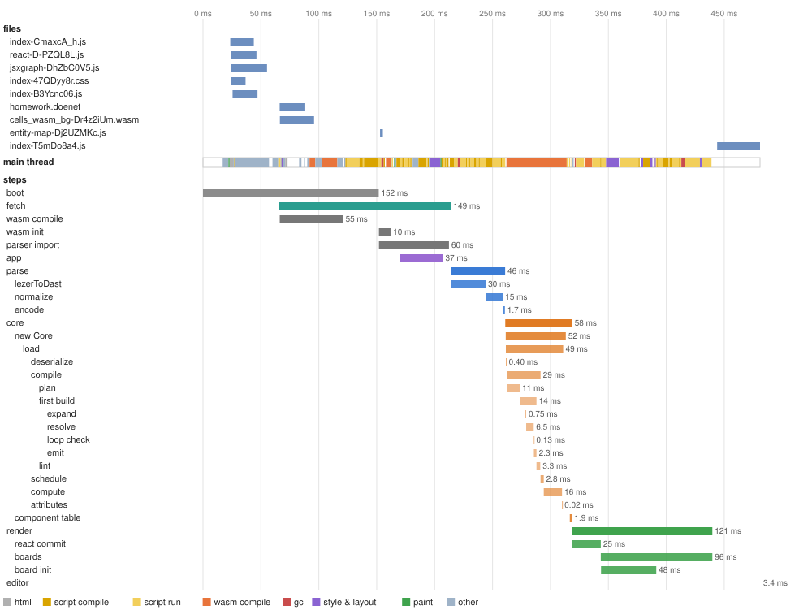
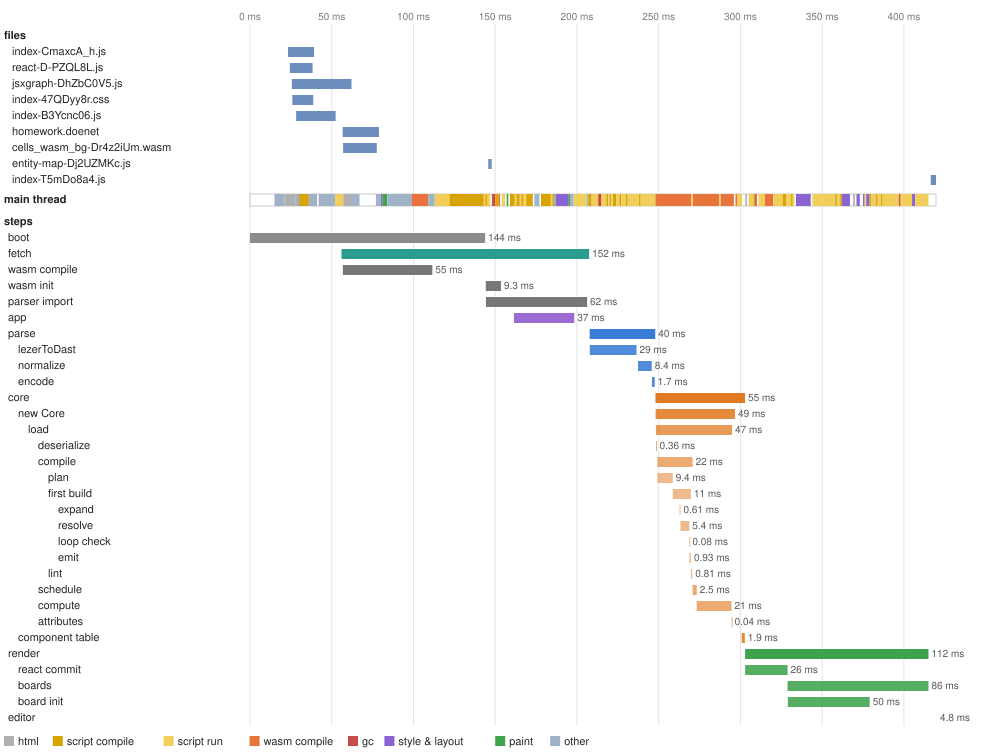
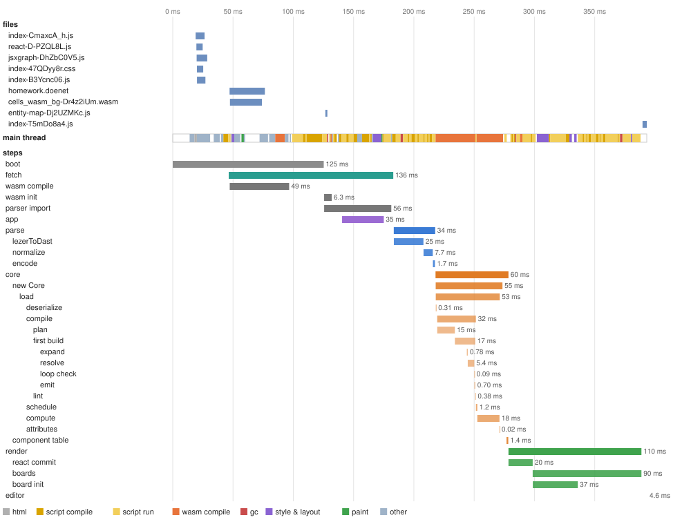
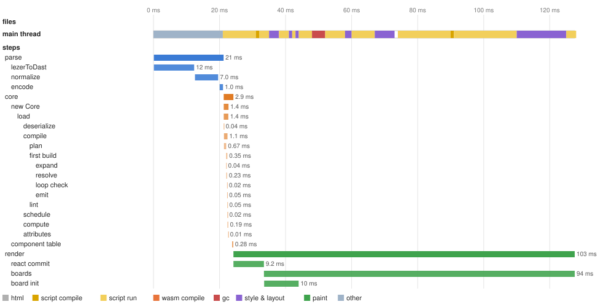

# Load trace: 2026-10-21-claude-cloud-a8cb91711

Machine **claude-cloud** (Intel(R) Xeon(R) Processor @ 2.80GHz, 4 cores, 16093 MB, Linux 6.18.44-fc-v139 x64, Node v22.22.0); commit `a8cb91711`; 2026-10-21.

Builds: cells: wasm-pack --release (npm run build -w packages/cells-core).

What the cells viewer does to get from DoenetML text to the first render, step by step, in the order it does it, and what the browser does underneath. Each scenario loads the page by navigation from the viewer's build, served as a host would serve it, and ends at the first render (the `render` step's end). Step times are medians of 5 runs. The figures are of one more run made under a Chrome performance trace, which slows the page somewhat, so their times run a little above the tables'. A step's name is its path: `parse/lezerToDast` is part of `parse`. What every step does, and where its code is, is under [Steps](#steps). How the layer works: [METHOD.md](../../../METHOD.md#the-trace-layer).

## First render

Navigation (or, for `edit`, the Refresh) to the first render, median; under it the fastest and slowest run.

| Scenario (homework) | CPU ×1 | CPU ×4 |
|---|---|---|
| editor page, cold | **392 ms** 368 ms–407 ms | **1.59 s** 1.51 s–1.66 s |
| editor page, warm | **390 ms** 342 ms–401 ms | **1.53 s** 1.52 s–1.71 s |
| editor page, hot | **348 ms** 336 ms–376 ms | **1.58 s** 1.51 s–1.71 s |
| editor page, edit | **172 ms** 151 ms–174 ms | **577 ms** 515 ms–654 ms |
| viewer page, cold | **358 ms** 342 ms–366 ms | **1.57 s** 1.43 s–1.81 s |
| viewer page, warm | **342 ms** 309 ms–364 ms | **1.55 s** 1.50 s–1.77 s |
| viewer page, hot | **343 ms** 327 ms–361 ms | **1.51 s** 1.34 s–1.64 s |
| viewer page, edit | **51 ms** 45 ms–54 ms | **281 ms** 253 ms–308 ms |

- **cold**: a first visit: a new browser profile, nothing cached.
- **warm**: a second visit: the files in the HTTP cache; Chromium caches compiled code for the larger scripts during this visit.
- **hot**: a third visit: the first that could use that compiled code (whether it did shows in script compile, under The main thread by kind of work).
- **edit**: the open page given a changed document, as the editor's Refresh does.

## editor page, cold, CPU ×1

A first visit: a new browser profile, nothing cached. First render **392 ms**.

The traced run: first render 440 ms. Top: the files the page fetched (from the cache when the tooltip says so). Middle: what the main thread did, by kind. Bottom: the steps. Hover a bar for its numbers.

| Step | Starts at | Takes | Work |
|---|---|---|---|
| boot | 0.00 ms | 138 ms |  |
| fetch | 41 ms | 146 ms | 3,922 chars |
| wasm compile | 42 ms | 57 ms |  |
| wasm init | 138 ms | 5.9 ms | 1 precompiled |
| parser import | 138 ms | 44 ms |  |
| app | 150 ms | 27 ms |  |
| parse | 192 ms | 35 ms | 3,922 chars |
| &nbsp;&nbsp;lezerToDast | 192 ms | 27 ms | 3,922 chars |
| &nbsp;&nbsp;normalize | 218 ms | 7.0 ms |  |
| &nbsp;&nbsp;encode | 225 ms | 1.6 ms |  |
| core | 227 ms | 53 ms |  |
| &nbsp;&nbsp;new Core | 227 ms | 46 ms | 12,920 bytes |
| &nbsp;&nbsp;&nbsp;&nbsp;load | 227 ms | 45 ms |  |
| &nbsp;&nbsp;&nbsp;&nbsp;&nbsp;&nbsp;deserialize | 227 ms | 0.29 ms | 12,920 bytes, 379 dast nodes |
| &nbsp;&nbsp;&nbsp;&nbsp;&nbsp;&nbsp;compile | 228 ms | 21 ms |  |
| &nbsp;&nbsp;&nbsp;&nbsp;&nbsp;&nbsp;&nbsp;&nbsp;plan | 228 ms | 8.5 ms | 122 elements, 2 templates |
| &nbsp;&nbsp;&nbsp;&nbsp;&nbsp;&nbsp;&nbsp;&nbsp;first build | 237 ms | 11 ms |  |
| &nbsp;&nbsp;&nbsp;&nbsp;&nbsp;&nbsp;&nbsp;&nbsp;&nbsp;&nbsp;expand | 241 ms | 0.58 ms |  |
| &nbsp;&nbsp;&nbsp;&nbsp;&nbsp;&nbsp;&nbsp;&nbsp;&nbsp;&nbsp;resolve | 242 ms | 5.4 ms |  |
| &nbsp;&nbsp;&nbsp;&nbsp;&nbsp;&nbsp;&nbsp;&nbsp;&nbsp;&nbsp;loop check | 247 ms | 0.10 ms |  |
| &nbsp;&nbsp;&nbsp;&nbsp;&nbsp;&nbsp;&nbsp;&nbsp;&nbsp;&nbsp;emit | 247 ms | 0.81 ms | 467 cells, 124 components, 95 instructions |
| &nbsp;&nbsp;&nbsp;&nbsp;&nbsp;&nbsp;&nbsp;&nbsp;lint | 248 ms | 0.42 ms |  |
| &nbsp;&nbsp;&nbsp;&nbsp;&nbsp;&nbsp;schedule | 249 ms | 1.7 ms | 95 instructions |
| &nbsp;&nbsp;&nbsp;&nbsp;&nbsp;&nbsp;compute | 250 ms | 22 ms | 467 cells |
| &nbsp;&nbsp;&nbsp;&nbsp;&nbsp;&nbsp;attributes | 273 ms | 0.02 ms |  |
| &nbsp;&nbsp;component table | 281 ms | 1.9 ms | 124 components |
| render | 284 ms | 112 ms | 124 components, 381 elements |
| &nbsp;&nbsp;react commit | 284 ms | 19 ms | 124 components |
| &nbsp;&nbsp;boards | 303 ms | 90 ms | 1 boards |
| &nbsp;&nbsp;board init | 303 ms | 41 ms |  |
| editor | 578 ms | 4.2 ms |  |

The main thread in the traced run, by kind of work (other threads' work is not counted; see below):

| Kind | Time | Share | What it is |
|---|---|---|---|
| html | 8.0 ms | 2% | parsing the HTML |
| script compile | 82 ms | 19% | V8 parsing and compiling JavaScript (including lazy compiles of functions on their first call) |
| script run | 134 ms | 30% | running JavaScript: the page's code, React, the parser, JSXGraph |
| wasm compile | 75 ms | 17% | compiling WebAssembly (eager validation, and lazy compiles of functions on their first call) |
| gc | 7.0 ms | 2% | garbage collection |
| style & layout | 29 ms | 6% | computing styles and laying out the page |
| paint | 3.4 ms | 1% | painting and handing the frame to the compositor |
| other | 66 ms | 15% | the browser's own task handling and work of no kind above (loading, messages) |
| idle | 35 ms | 8% | waiting: for the network, a timer or the next frame |

## editor page, warm, CPU ×1

A second visit: the files in the HTTP cache; Chromium caches compiled code for the larger scripts during this visit. First render **390 ms**.

The traced run: first render 415 ms. Top: the files the page fetched (from the cache when the tooltip says so). Middle: what the main thread did, by kind. Bottom: the steps. Hover a bar for its numbers.

| Step | Starts at | Takes | Work |
|---|---|---|---|
| boot | 0.00 ms | 136 ms |  |
| fetch | 44 ms | 140 ms | 3,922 chars |
| wasm compile | 45 ms | 53 ms |  |
| wasm init | 136 ms | 5.5 ms | 1 precompiled |
| parser import | 136 ms | 40 ms |  |
| app | 147 ms | 26 ms |  |
| parse | 185 ms | 40 ms | 3,922 chars |
| &nbsp;&nbsp;lezerToDast | 185 ms | 30 ms | 3,922 chars |
| &nbsp;&nbsp;normalize | 219 ms | 8.9 ms |  |
| &nbsp;&nbsp;encode | 230 ms | 1.8 ms |  |
| core | 232 ms | 51 ms |  |
| &nbsp;&nbsp;new Core | 232 ms | 45 ms | 12,920 bytes |
| &nbsp;&nbsp;&nbsp;&nbsp;load | 232 ms | 43 ms |  |
| &nbsp;&nbsp;&nbsp;&nbsp;&nbsp;&nbsp;deserialize | 232 ms | 0.29 ms | 12,920 bytes, 379 dast nodes |
| &nbsp;&nbsp;&nbsp;&nbsp;&nbsp;&nbsp;compile | 233 ms | 21 ms |  |
| &nbsp;&nbsp;&nbsp;&nbsp;&nbsp;&nbsp;&nbsp;&nbsp;plan | 233 ms | 8.8 ms | 122 elements, 2 templates |
| &nbsp;&nbsp;&nbsp;&nbsp;&nbsp;&nbsp;&nbsp;&nbsp;first build | 242 ms | 12 ms |  |
| &nbsp;&nbsp;&nbsp;&nbsp;&nbsp;&nbsp;&nbsp;&nbsp;&nbsp;&nbsp;expand | 246 ms | 0.56 ms |  |
| &nbsp;&nbsp;&nbsp;&nbsp;&nbsp;&nbsp;&nbsp;&nbsp;&nbsp;&nbsp;resolve | 247 ms | 6.2 ms |  |
| &nbsp;&nbsp;&nbsp;&nbsp;&nbsp;&nbsp;&nbsp;&nbsp;&nbsp;&nbsp;loop check | 255 ms | 0.10 ms |  |
| &nbsp;&nbsp;&nbsp;&nbsp;&nbsp;&nbsp;&nbsp;&nbsp;&nbsp;&nbsp;emit | 255 ms | 0.94 ms | 467 cells, 124 components, 95 instructions |
| &nbsp;&nbsp;&nbsp;&nbsp;&nbsp;&nbsp;&nbsp;&nbsp;lint | 256 ms | 0.75 ms |  |
| &nbsp;&nbsp;&nbsp;&nbsp;&nbsp;&nbsp;schedule | 257 ms | 2.3 ms | 95 instructions |
| &nbsp;&nbsp;&nbsp;&nbsp;&nbsp;&nbsp;compute | 260 ms | 18 ms | 467 cells |
| &nbsp;&nbsp;&nbsp;&nbsp;&nbsp;&nbsp;attributes | 278 ms | 0.02 ms |  |
| &nbsp;&nbsp;component table | 284 ms | 1.6 ms | 124 components |
| render | 287 ms | 106 ms | 124 components, 381 elements |
| &nbsp;&nbsp;react commit | 287 ms | 20 ms | 124 components |
| &nbsp;&nbsp;boards | 307 ms | 83 ms | 1 boards |
| &nbsp;&nbsp;board init | 307 ms | 38 ms |  |
| editor | 569 ms | 3.7 ms |  |

The main thread in the traced run, by kind of work (other threads' work is not counted; see below):

| Kind | Time | Share | What it is |
|---|---|---|---|
| html | 17 ms | 4% | parsing the HTML |
| script compile | 83 ms | 20% | V8 parsing and compiling JavaScript (including lazy compiles of functions on their first call) |
| script run | 131 ms | 32% | running JavaScript: the page's code, React, the parser, JSXGraph |
| wasm compile | 60 ms | 15% | compiling WebAssembly (eager validation, and lazy compiles of functions on their first call) |
| gc | 6.3 ms | 2% | garbage collection |
| style & layout | 31 ms | 7% | computing styles and laying out the page |
| paint | 5.1 ms | 1% | painting and handing the frame to the compositor |
| other | 54 ms | 13% | the browser's own task handling and work of no kind above (loading, messages) |
| idle | 28 ms | 7% | waiting: for the network, a timer or the next frame |

## editor page, hot, CPU ×1

A third visit: the first that could use that compiled code (whether it did shows in script compile, under The main thread by kind of work). First render **348 ms**.

The traced run: first render 389 ms. Top: the files the page fetched (from the cache when the tooltip says so). Middle: what the main thread did, by kind. Bottom: the steps. Hover a bar for its numbers.

| Step | Starts at | Takes | Work |
|---|---|---|---|
| boot | 0.00 ms | 116 ms |  |
| fetch | 39 ms | 127 ms | 3,922 chars |
| wasm compile | 40 ms | 45 ms |  |
| wasm init | 116 ms | 5.5 ms | 1 precompiled |
| parser import | 117 ms | 45 ms |  |
| app | 129 ms | 26 ms |  |
| parse | 163 ms | 35 ms | 3,922 chars |
| &nbsp;&nbsp;lezerToDast | 163 ms | 25 ms | 3,922 chars |
| &nbsp;&nbsp;normalize | 192 ms | 6.8 ms |  |
| &nbsp;&nbsp;encode | 200 ms | 2.0 ms |  |
| core | 202 ms | 52 ms |  |
| &nbsp;&nbsp;new Core | 202 ms | 47 ms | 12,920 bytes |
| &nbsp;&nbsp;&nbsp;&nbsp;load | 202 ms | 45 ms |  |
| &nbsp;&nbsp;&nbsp;&nbsp;&nbsp;&nbsp;deserialize | 202 ms | 0.30 ms | 12,920 bytes, 379 dast nodes |
| &nbsp;&nbsp;&nbsp;&nbsp;&nbsp;&nbsp;compile | 202 ms | 23 ms |  |
| &nbsp;&nbsp;&nbsp;&nbsp;&nbsp;&nbsp;&nbsp;&nbsp;plan | 203 ms | 9.1 ms | 122 elements, 2 templates |
| &nbsp;&nbsp;&nbsp;&nbsp;&nbsp;&nbsp;&nbsp;&nbsp;first build | 211 ms | 12 ms |  |
| &nbsp;&nbsp;&nbsp;&nbsp;&nbsp;&nbsp;&nbsp;&nbsp;&nbsp;&nbsp;expand | 218 ms | 0.62 ms |  |
| &nbsp;&nbsp;&nbsp;&nbsp;&nbsp;&nbsp;&nbsp;&nbsp;&nbsp;&nbsp;resolve | 218 ms | 5.1 ms |  |
| &nbsp;&nbsp;&nbsp;&nbsp;&nbsp;&nbsp;&nbsp;&nbsp;&nbsp;&nbsp;loop check | 224 ms | 0.07 ms |  |
| &nbsp;&nbsp;&nbsp;&nbsp;&nbsp;&nbsp;&nbsp;&nbsp;&nbsp;&nbsp;emit | 224 ms | 0.87 ms | 467 cells, 124 components, 95 instructions |
| &nbsp;&nbsp;&nbsp;&nbsp;&nbsp;&nbsp;&nbsp;&nbsp;lint | 225 ms | 0.58 ms |  |
| &nbsp;&nbsp;&nbsp;&nbsp;&nbsp;&nbsp;schedule | 226 ms | 1.6 ms | 95 instructions |
| &nbsp;&nbsp;&nbsp;&nbsp;&nbsp;&nbsp;compute | 227 ms | 19 ms | 467 cells |
| &nbsp;&nbsp;&nbsp;&nbsp;&nbsp;&nbsp;attributes | 246 ms | 0.03 ms |  |
| &nbsp;&nbsp;component table | 251 ms | 2.0 ms | 124 components |
| render | 254 ms | 100 ms | 124 components, 381 elements |
| &nbsp;&nbsp;react commit | 254 ms | 18 ms | 124 components |
| &nbsp;&nbsp;boards | 271 ms | 83 ms | 1 boards |
| &nbsp;&nbsp;board init | 271 ms | 35 ms |  |
| editor | 542 ms | 4.1 ms |  |

The main thread in the traced run, by kind of work (other threads' work is not counted; see below):

| Kind | Time | Share | What it is |
|---|---|---|---|
| html | 5.8 ms | 2% | parsing the HTML |
| script compile | 76 ms | 19% | V8 parsing and compiling JavaScript (including lazy compiles of functions on their first call) |
| script run | 130 ms | 33% | running JavaScript: the page's code, React, the parser, JSXGraph |
| wasm compile | 62 ms | 16% | compiling WebAssembly (eager validation, and lazy compiles of functions on their first call) |
| gc | 5.5 ms | 1% | garbage collection |
| style & layout | 26 ms | 7% | computing styles and laying out the page |
| paint | 3.0 ms | 1% | painting and handing the frame to the compositor |
| other | 48 ms | 12% | the browser's own task handling and work of no kind above (loading, messages) |
| idle | 33 ms | 9% | waiting: for the network, a timer or the next frame |

## editor page, edit, CPU ×1

The open page given a changed document, as the editor's Refresh does. First render **172 ms**.

The traced run: first render 128 ms. Top: the files the page fetched (from the cache when the tooltip says so). Middle: what the main thread did, by kind. Bottom: the steps. Hover a bar for its numbers.

| Step | Starts at | Takes | Work |
|---|---|---|---|
| parse | 0.10 ms | 18 ms | 3,938 chars |
| &nbsp;&nbsp;lezerToDast | 0.11 ms | 13 ms | 3,938 chars |
| &nbsp;&nbsp;normalize | 13 ms | 3.7 ms |  |
| &nbsp;&nbsp;encode | 18 ms | 0.87 ms |  |
| core | 19 ms | 3.5 ms |  |
| &nbsp;&nbsp;new Core | 19 ms | 1.8 ms | 13,004 bytes |
| &nbsp;&nbsp;&nbsp;&nbsp;load | 19 ms | 1.7 ms |  |
| &nbsp;&nbsp;&nbsp;&nbsp;&nbsp;&nbsp;deserialize | 19 ms | 0.04 ms | 13,004 bytes, 382 dast nodes |
| &nbsp;&nbsp;&nbsp;&nbsp;&nbsp;&nbsp;compile | 19 ms | 1.2 ms |  |
| &nbsp;&nbsp;&nbsp;&nbsp;&nbsp;&nbsp;&nbsp;&nbsp;plan | 19 ms | 0.68 ms | 123 elements, 2 templates |
| &nbsp;&nbsp;&nbsp;&nbsp;&nbsp;&nbsp;&nbsp;&nbsp;first build | 19 ms | 0.51 ms |  |
| &nbsp;&nbsp;&nbsp;&nbsp;&nbsp;&nbsp;&nbsp;&nbsp;&nbsp;&nbsp;expand | 19 ms | 0.03 ms |  |
| &nbsp;&nbsp;&nbsp;&nbsp;&nbsp;&nbsp;&nbsp;&nbsp;&nbsp;&nbsp;resolve | 19 ms | 0.34 ms |  |
| &nbsp;&nbsp;&nbsp;&nbsp;&nbsp;&nbsp;&nbsp;&nbsp;&nbsp;&nbsp;loop check | 20 ms | 0.02 ms |  |
| &nbsp;&nbsp;&nbsp;&nbsp;&nbsp;&nbsp;&nbsp;&nbsp;&nbsp;&nbsp;emit | 20 ms | 0.05 ms | 467 cells, 125 components, 95 instructions |
| &nbsp;&nbsp;&nbsp;&nbsp;&nbsp;&nbsp;&nbsp;&nbsp;lint | 20 ms | 0.05 ms |  |
| &nbsp;&nbsp;&nbsp;&nbsp;&nbsp;&nbsp;schedule | 20 ms | 0.02 ms | 95 instructions |
| &nbsp;&nbsp;&nbsp;&nbsp;&nbsp;&nbsp;compute | 20 ms | 0.21 ms | 467 cells |
| &nbsp;&nbsp;&nbsp;&nbsp;&nbsp;&nbsp;attributes | 20 ms | 0.01 ms |  |
| &nbsp;&nbsp;component table | 23 ms | 0.27 ms | 125 components |
| render | 23 ms | 148 ms | 125 components, 1,648 elements |
| &nbsp;&nbsp;react commit | 23 ms | 12 ms | 125 components |
| &nbsp;&nbsp;boards | 34 ms | 136 ms | 1 boards |
| &nbsp;&nbsp;board init | 34 ms | 13 ms |  |

The main thread in the traced run, by kind of work (other threads' work is not counted; see below):

| Kind | Time | Share | What it is |
|---|---|---|---|
| html | 0.06 ms | 0% | parsing the HTML |
| script compile | 6.7 ms | 5% | V8 parsing and compiling JavaScript (including lazy compiles of functions on their first call) |
| script run | 69 ms | 54% | running JavaScript: the page's code, React, the parser, JSXGraph |
| wasm compile | 0.08 ms | 0% | compiling WebAssembly (eager validation, and lazy compiles of functions on their first call) |
| gc | 3.5 ms | 3% | garbage collection |
| style & layout | 28 ms | 22% | computing styles and laying out the page |
| other | 21 ms | 16% | the browser's own task handling and work of no kind above (loading, messages) |
| idle | 0.02 ms | 0% | waiting: for the network, a timer or the next frame |

## Visits compared: editor page, CPU ×1

The same document on each visit. A step that shrinks from cold to hot was paying for something the browser caches (files, compiled code); one that does not is work done on every load. A step can also take longer only because the main thread was busy with something else when it was due: compare the main-thread lanes in the figures above.

| Step | cold | warm | hot | edit |
|---|---|---|---|---|
| boot | 138 ms | 136 ms | 116 ms | 0.00 ms |
| fetch | 146 ms | 140 ms | 127 ms | 0.00 ms |
| wasm compile | 57 ms | 53 ms | 45 ms | 0.00 ms |
| wasm init | 5.9 ms | 5.5 ms | 5.5 ms | 0.00 ms |
| parser import | 44 ms | 40 ms | 45 ms | 0.00 ms |
| app | 27 ms | 26 ms | 26 ms | 0.00 ms |
| parse | 35 ms | 40 ms | 35 ms | 18 ms |
| &nbsp;&nbsp;lezerToDast | 27 ms | 30 ms | 25 ms | 13 ms |
| &nbsp;&nbsp;normalize | 7.0 ms | 8.9 ms | 6.8 ms | 3.7 ms |
| &nbsp;&nbsp;encode | 1.6 ms | 1.8 ms | 2.0 ms | 0.87 ms |
| core | 53 ms | 51 ms | 52 ms | 3.5 ms |
| &nbsp;&nbsp;new Core | 46 ms | 45 ms | 47 ms | 1.8 ms |
| &nbsp;&nbsp;component table | 1.9 ms | 1.6 ms | 2.0 ms | 0.27 ms |
| render | 112 ms | 106 ms | 100 ms | 148 ms |
| &nbsp;&nbsp;react commit | 19 ms | 20 ms | 18 ms | 12 ms |
| &nbsp;&nbsp;boards | 90 ms | 83 ms | 83 ms | 136 ms |
| &nbsp;&nbsp;board init | 41 ms | 38 ms | 35 ms | 13 ms |
| editor | 4.2 ms | 3.7 ms | 4.1 ms | 0.00 ms |
| **first render** | **392 ms** | **390 ms** | **348 ms** | **172 ms** |

## The editor page and the viewer alone, cold, CPU ×1

Both load the same bundle; the viewer alone (`?editor=0`) does not mount the editor. The difference is what mounting the editor costs a load.

| Step | editor | viewer |
|---|---|---|
| boot | 138 ms | 131 ms |
| fetch | 146 ms | 127 ms |
| wasm compile | 57 ms | 60 ms |
| wasm init | 5.9 ms | 6.5 ms |
| parser import | 44 ms | 33 ms |
| app | 27 ms | 9.7 ms |
| parse | 35 ms | 36 ms |
| &nbsp;&nbsp;lezerToDast | 27 ms | 26 ms |
| &nbsp;&nbsp;normalize | 7.0 ms | 7.6 ms |
| &nbsp;&nbsp;encode | 1.6 ms | 1.5 ms |
| core | 53 ms | 48 ms |
| &nbsp;&nbsp;new Core | 46 ms | 43 ms |
| &nbsp;&nbsp;component table | 1.9 ms | 1.3 ms |
| render | 112 ms | 111 ms |
| &nbsp;&nbsp;react commit | 19 ms | 28 ms |
| &nbsp;&nbsp;boards | 90 ms | 80 ms |
| &nbsp;&nbsp;board init | 41 ms | 43 ms |
| editor | 4.2 ms | 0.00 ms |
| **first render** | **392 ms** | **358 ms** |

## A slower device: editor page, cold

Chromium's CPU throttling slows the page's threads by the factor named, standing in for a slower device. The network is not slowed.

| Step | CPU ×1 | CPU ×4 |
|---|---|---|
| boot | 138 ms | 371 ms |
| fetch | 146 ms | 525 ms |
| wasm compile | 57 ms | 140 ms |
| wasm init | 5.9 ms | 31 ms |
| parser import | 44 ms | 270 ms |
| app | 27 ms | 165 ms |
| parse | 35 ms | 154 ms |
| &nbsp;&nbsp;lezerToDast | 27 ms | 100 ms |
| &nbsp;&nbsp;normalize | 7.0 ms | 40 ms |
| &nbsp;&nbsp;encode | 1.6 ms | 9.5 ms |
| core | 53 ms | 267 ms |
| &nbsp;&nbsp;new Core | 46 ms | 239 ms |
| &nbsp;&nbsp;component table | 1.9 ms | 7.5 ms |
| render | 112 ms | 493 ms |
| &nbsp;&nbsp;react commit | 19 ms | 102 ms |
| &nbsp;&nbsp;boards | 90 ms | 393 ms |
| &nbsp;&nbsp;board init | 41 ms | 173 ms |
| editor | 4.2 ms | 0.00 ms |
| **first render** | **392 ms** | **1.59 s** |

## The document's size: editor page, cold, CPU ×1

`homework-x<n>` is the homework page repeated in n sections. The last column is how much the step grew from ×1 to ×16: near 1 is a fixed cost of the page, near 16 is work proportional to the document.

| Step | ×1 | ×4 | ×16 | growth |
|---|---|---|---|---|
| boot | 138 ms | 133 ms | 126 ms | 0.9× |
| fetch | 146 ms | 140 ms | 126 ms | 0.9× |
| wasm compile | 57 ms | 49 ms | 55 ms | 1.0× |
| wasm init | 5.9 ms | 5.4 ms | 6.2 ms | 1.0× |
| parser import | 44 ms | 49 ms | 40 ms | 0.9× |
| app | 27 ms | 29 ms | 23 ms | 0.9× |
| parse | 35 ms | 66 ms | 140 ms | 3.9× |
| &nbsp;&nbsp;lezerToDast | 27 ms | 46 ms | 102 ms | 3.8× |
| &nbsp;&nbsp;normalize | 7.0 ms | 17 ms | 35 ms | 5.0× |
| &nbsp;&nbsp;encode | 1.6 ms | 4.3 ms | 6.6 ms | 4.1× |
| core | 53 ms | 60 ms | 127 ms | 2.4× |
| &nbsp;&nbsp;new Core | 46 ms | 51 ms | 107 ms | 2.3× |
| &nbsp;&nbsp;&nbsp;&nbsp;&nbsp;&nbsp;deserialize | 0.29 ms | 0.40 ms | 0.71 ms | 2.4× |
| &nbsp;&nbsp;&nbsp;&nbsp;&nbsp;&nbsp;compile | 21 ms | 28 ms | 70 ms | 3.4× |
| &nbsp;&nbsp;&nbsp;&nbsp;&nbsp;&nbsp;&nbsp;&nbsp;plan | 8.5 ms | 11 ms | 28 ms | 3.3× |
| &nbsp;&nbsp;&nbsp;&nbsp;&nbsp;&nbsp;&nbsp;&nbsp;first build | 11 ms | 16 ms | 40 ms | 3.5× |
| &nbsp;&nbsp;&nbsp;&nbsp;&nbsp;&nbsp;&nbsp;&nbsp;lint | 0.42 ms | 0.62 ms | 1.8 ms | 4.2× |
| &nbsp;&nbsp;&nbsp;&nbsp;&nbsp;&nbsp;schedule | 1.7 ms | 2.0 ms | 2.8 ms | 1.6× |
| &nbsp;&nbsp;&nbsp;&nbsp;&nbsp;&nbsp;compute | 22 ms | 18 ms | 28 ms | 1.3× |
| &nbsp;&nbsp;&nbsp;&nbsp;&nbsp;&nbsp;attributes | 0.02 ms | 0.06 ms | 0.19 ms | 9.5× |
| &nbsp;&nbsp;component table | 1.9 ms | 2.1 ms | 3.2 ms | 1.6× |
| render | 112 ms | 201 ms | 464 ms | 4.1× |
| &nbsp;&nbsp;react commit | 19 ms | 42 ms | 67 ms | 3.5× |
| &nbsp;&nbsp;boards | 90 ms | 159 ms | 389 ms | 4.3× |
| &nbsp;&nbsp;board init | 41 ms | 72 ms | 150 ms | 3.6× |
| editor | 4.2 ms | 3.3 ms | 3.3 ms | 0.8× |
| **first render** | **392 ms** | **515 ms** | **899 ms** | 2.3× |

Work done at each size, from the core's counts:

| Size | Source | DAST nodes | Components | Cells | Instructions |
|---|---|---|---|---|---|
| ×1 | 3,922 chars | 379 | 124 | 467 | 95 |
| ×4 | 15,370 chars | 1,527 | 495 | 1,891 | 376 |
| ×16 | 60,960 chars | 6,087 | 1,971 | 7,551 | 1,496 |

## The document's size: editor page, edit, CPU ×1

`homework-x<n>` is the homework page repeated in n sections. The last column is how much the step grew from ×1 to ×16: near 1 is a fixed cost of the page, near 16 is work proportional to the document.

| Step | ×1 | ×4 | ×16 | growth |
|---|---|---|---|---|
| parse | 18 ms | 59 ms | 177 ms | 9.6× |
| &nbsp;&nbsp;lezerToDast | 13 ms | 36 ms | 132 ms | 10.3× |
| &nbsp;&nbsp;normalize | 3.7 ms | 17 ms | 31 ms | 8.5× |
| &nbsp;&nbsp;encode | 0.87 ms | 3.5 ms | 8.0 ms | 9.2× |
| core | 3.5 ms | 13 ms | 32 ms | 9.2× |
| &nbsp;&nbsp;new Core | 1.8 ms | 6.2 ms | 11 ms | 6.2× |
| &nbsp;&nbsp;&nbsp;&nbsp;&nbsp;&nbsp;deserialize | 0.04 ms | 0.12 ms | 0.34 ms | 8.5× |
| &nbsp;&nbsp;&nbsp;&nbsp;&nbsp;&nbsp;compile | 1.2 ms | 5.2 ms | 9.4 ms | 7.8× |
| &nbsp;&nbsp;&nbsp;&nbsp;&nbsp;&nbsp;&nbsp;&nbsp;plan | 0.68 ms | 2.9 ms | 3.8 ms | 5.6× |
| &nbsp;&nbsp;&nbsp;&nbsp;&nbsp;&nbsp;&nbsp;&nbsp;first build | 0.51 ms | 2.0 ms | 5.1 ms | 10.0× |
| &nbsp;&nbsp;&nbsp;&nbsp;&nbsp;&nbsp;&nbsp;&nbsp;lint | 0.05 ms | 0.27 ms | 0.32 ms | 6.4× |
| &nbsp;&nbsp;&nbsp;&nbsp;&nbsp;&nbsp;schedule | 0.02 ms | 0.05 ms | 0.20 ms | 10.0× |
| &nbsp;&nbsp;&nbsp;&nbsp;&nbsp;&nbsp;compute | 0.21 ms | 0.25 ms | 0.65 ms | 3.1× |
| &nbsp;&nbsp;&nbsp;&nbsp;&nbsp;&nbsp;attributes | 0.01 ms | 0.03 ms | 0.35 ms | 35.0× |
| &nbsp;&nbsp;component table | 0.27 ms | 0.55 ms | 1.2 ms | 4.5× |
| render | 148 ms | 244 ms | 438 ms | 3.0× |
| &nbsp;&nbsp;react commit | 12 ms | 46 ms | 82 ms | 6.8× |
| &nbsp;&nbsp;boards | 136 ms | 199 ms | 353 ms | 2.6× |
| &nbsp;&nbsp;board init | 13 ms | 50 ms | 109 ms | 8.3× |
| **first render** | **172 ms** | **318 ms** | **652 ms** | 3.8× |

Work done at each size, from the core's counts:

| Size | Source | DAST nodes | Components | Cells | Instructions |
|---|---|---|---|---|---|
| ×1 | 3,938 chars | 382 | 125 | 467 | 95 |
| ×4 | 15,386 chars | 1,530 | 496 | 1,891 | 376 |
| ×16 | 60,976 chars | 6,090 | 1,972 | 7,551 | 1,496 |

## The main thread by kind of work

Every traced run of `homework`, from its start to its first render. Each millisecond is given to the innermost trace event covering it (`src/chrome-trace.mjs`). Only the main thread: work on other threads (a script compiled while it streams in, wasm optimized in the background, the editor's language server in its worker) is not here, and shows as idle when the main thread waits on it.

| Scenario | html | script compile | script run | wasm compile | gc | style & layout | paint | other | idle | first render (traced) |
|---|---|---|---|---|---|---|---|---|---|---|
| editor, cold, CPU ×1 | 8.0 ms | 82 ms | 134 ms | 75 ms | 7.0 ms | 29 ms | 3.4 ms | 66 ms | 35 ms | 440 ms |
| editor, warm, CPU ×1 | 17 ms | 83 ms | 131 ms | 60 ms | 6.3 ms | 31 ms | 5.1 ms | 54 ms | 28 ms | 415 ms |
| editor, hot, CPU ×1 | 5.8 ms | 76 ms | 130 ms | 62 ms | 5.5 ms | 26 ms | 3.0 ms | 48 ms | 33 ms | 389 ms |
| editor, edit, CPU ×1 | 0.06 ms | 6.7 ms | 69 ms | 0.08 ms | 3.5 ms | 28 ms | 0.00 ms | 21 ms | 0.02 ms | 128 ms |
| editor, cold, CPU ×4 | 41 ms | 337 ms | 573 ms | 257 ms | 20 ms | 92 ms | 11 ms | 171 ms | 28 ms | 1.53 s |
| editor, warm, CPU ×4 | 28 ms | 464 ms | 709 ms | 310 ms | 18 ms | 99 ms | 24 ms | 191 ms | 33 ms | 1.88 s |
| editor, hot, CPU ×4 | 41 ms | 416 ms | 648 ms | 276 ms | 29 ms | 107 ms | 15 ms | 179 ms | 27 ms | 1.74 s |
| editor, edit, CPU ×4 | 1.3 ms | 38 ms | 338 ms | 0.81 ms | 16 ms | 169 ms | 0.95 ms | 79 ms | 0.08 ms | 642 ms |
| viewer, cold, CPU ×1 | 10 ms | 76 ms | 112 ms | 49 ms | 5.5 ms | 23 ms | 2.0 ms | 60 ms | 36 ms | 373 ms |
| viewer, warm, CPU ×1 | 15 ms | 75 ms | 120 ms | 58 ms | 5.7 ms | 21 ms | 2.6 ms | 51 ms | 19 ms | 367 ms |
| viewer, hot, CPU ×1 | 9.7 ms | 82 ms | 134 ms | 59 ms | 8.2 ms | 24 ms | 5.4 ms | 62 ms | 22 ms | 407 ms |
| viewer, edit, CPU ×1 | 0.06 ms | 3.4 ms | 29 ms | 0.16 ms | 2.8 ms | 5.2 ms | 0.00 ms | 17 ms | 0.03 ms | 57 ms |
| viewer, cold, CPU ×4 | 23 ms | 380 ms | 596 ms | 253 ms | 21 ms | 81 ms | 11 ms | 165 ms | 29 ms | 1.56 s |
| viewer, warm, CPU ×4 | 26 ms | 408 ms | 731 ms | 302 ms | 26 ms | 95 ms | 19 ms | 166 ms | 21 ms | 1.79 s |
| viewer, hot, CPU ×4 | 43 ms | 388 ms | 616 ms | 282 ms | 28 ms | 96 ms | 14 ms | 176 ms | 33 ms | 1.68 s |
| viewer, edit, CPU ×4 | 0.08 ms | 16 ms | 185 ms | 0.54 ms | 1.8 ms | 34 ms | 0.00 ms | 59 ms | 0.05 ms | 296 ms |

## Steps

In the order a load runs them. Indented steps are part of the step above. The stages of a build (expand, resolve, loop check, emit) run inside whichever step builds: the compile's check, or a later build pass.

| Step | What it does | Where |
|---|---|---|
| `boot` | From navigation until the page's own code starts: the HTML, then downloading, parsing, compiling and running every eagerly loaded script (React, JSXGraph and the viewer, each its own script so they compile on separate background threads as they stream in; the editor's code is not among them). Nothing about the document has happened yet, except what the page's head started: the text's fetch and the wasm's compile (`wasm compile`). | `packages/cells-viewer/dev/main.tsx (top of the module)` |
| `wasm compile` | The core's wasm fetched and compiled, on a background thread, by a script in the built page's head: started before the page's own scripts have arrived, and over before they need it. Only the first load on a page has it; the dev server's page, which has no such head, fetches the wasm in `wasm init` instead. | `packages/cells-viewer/vite.config.ts (headScript)` |
| `wasm init` | The core's wasm instantiated from that compile (or fetched and compiled here, without it): started as soon as the page's code runs, alongside `app`, `fetch` and `parse`, rather than when the first document's bytes are ready. Once per page. | `packages/cells-viewer/src/core.ts (preloadCore)` |
| `parser import` | The parser's code (@doenet/parser), a chunk of its own, preloaded by the page and imported as soon as the page's code runs, so it is in hand when the text is. | `packages/cells-viewer/src/parse.ts (preloadParser)` |
| `app` | React's first render of the page around the document: the toolbar and the panels beside an empty viewer, until its effects have run. The editor's code is not loaded yet. | `packages/cells-viewer/dev/main.tsx (App)` |
| `editor` | The editor's first mount (CodeMirror), once its code has loaded: after the first document has rendered (`src/editor-gate.ts`), so it is not part of the first render. | `packages/cells-viewer/src/EditorViewer.tsx` |
| `fetch` | The DoenetML text requested from its URL, until the page handles the response. The network part is in the file lane; the rest is waiting for the main thread. | `packages/cells-viewer/dev/main.tsx (?src=)` |
| `parse` | DoenetML text to the bytes the core reads. | `packages/cells-viewer/src/parse.ts` |
| &nbsp;&nbsp;`import` | Waiting for the parser's code when a parse comes before `parser import` has finished; absent once it is in hand. | `packages/cells-viewer/src/parse.ts` |
| &nbsp;&nbsp;`lezerToDast` | The text parsed by the Lezer grammar into a syntax tree, then converted to a DAST (the document as a tree of elements, text and references). | `packages/parser/src/lezer-to-dast` |
| &nbsp;&nbsp;`normalize` | The DAST put in the shape the core expects: one <document> root, comments and XML-only nodes removed, component sugar expanded. | `packages/parser/src/dast-normalize/normalize-dast.ts` |
| &nbsp;&nbsp;`encode` | The DAST encoded in the core's binary wire format (ADR 0002). | `packages/cells-core/scripts/cdast-encode.mjs` |
| `core` | The bytes to a loaded core whose cells the renderer can read. | `packages/cells-viewer/src/core.ts (loadDocument)` |
| &nbsp;&nbsp;`wasm init` | Waiting for `wasm init`, on a page's first load: what the wasm's fetch, compile and instantiation, started at boot, had left to do when the bytes were ready. The wasm is compiled lazily, function by function, the first time each runs, so much of its compiling lands in `core/new Core`. | `packages/cells-viewer/src/core.ts` |
| &nbsp;&nbsp;`new Core` | The call into the core: its bytes are copied into wasm memory, then the load below runs. Time here and not in `load` is the copy and the call. | `packages/cells-core/crates/cells-wasm/src/lib.rs (Core::new)` |
| &nbsp;&nbsp;&nbsp;&nbsp;`load` | The core's load: compile once, then build until the structure settles (ADR 0015). | `packages/cells-core/crates/cells-core/src/document/load.rs` |
| &nbsp;&nbsp;&nbsp;&nbsp;&nbsp;&nbsp;`deserialize` | The wire format read into the core's DAST, in flat columns. | `packages/cells-core/crates/cells-core/src/dast/` |
| &nbsp;&nbsp;&nbsp;&nbsp;&nbsp;&nbsp;`compile` | Everything that depends only on the source, done once: plan, check, lint (ADR 0015). | `packages/cells-core/crates/cells-core/src/compile/check.rs` |
| &nbsp;&nbsp;&nbsp;&nbsp;&nbsp;&nbsp;&nbsp;&nbsp;`plan` | Every element planned by its type's planner into templates: where each prop's value comes from, every reference, every choice. Math text is parsed into expression trees here, once. | `packages/cells-core/crates/cells-core/src/compile/mod.rs, compile/planner.rs` |
| &nbsp;&nbsp;&nbsp;&nbsp;&nbsp;&nbsp;&nbsp;&nbsp;`probe` | Only with a repeat or a select: one build through the probe, which stands for every iteration count and every pick, to find every cycle and error the document can have. Discarded afterwards (ADR 0012, ADR 0014). | `packages/cells-core/crates/cells-core/src/build/probe.rs` |
| &nbsp;&nbsp;&nbsp;&nbsp;&nbsp;&nbsp;&nbsp;&nbsp;`first build` | Without a repeat or a select: the document's one build, which is also its check (the probe's loop check runs in it). The load keeps it instead of building again. | `packages/cells-core/crates/cells-core/src/build/mod.rs (first_build)` |
| &nbsp;&nbsp;&nbsp;&nbsp;&nbsp;&nbsp;&nbsp;&nbsp;`lint` | The accessibility rules, one walk over the DAST. | `packages/cells-core/crates/cells-core/src/compile/lint.rs` |
| &nbsp;&nbsp;&nbsp;&nbsp;&nbsp;&nbsp;`build` | A further build pass, when a repeat's count, computed by the pass before, differs from the count it was stamped with. | `packages/cells-core/crates/cells-core/src/build/mod.rs (build)` |
| &nbsp;&nbsp;&nbsp;&nbsp;&nbsp;&nbsp;`schedule` | The instructions sorted so each runs after the cells it reads. | `packages/cells-core/crates/cells-core/src/program/mod.rs (Program::schedule)` |
| &nbsp;&nbsp;&nbsp;&nbsp;&nbsp;&nbsp;`compute` | Every derived cell computed once: the document's first state. | `packages/cells-core/crates/cells-core/src/document/mod.rs (recompute), program/` |
| &nbsp;&nbsp;&nbsp;&nbsp;&nbsp;&nbsp;`attributes` | The source's literal attributes kept for the renderer (sizes, styles, text it shows as written). | `packages/cells-core/crates/cells-core/src/dast/attrs.rs` |
| &nbsp;&nbsp;`component table` | Views over wasm memory through which the renderer reads components and their cells without copying. | `packages/cells-viewer/src/components.ts` |
| `render` | From handing the loaded core to React until the first commit and every board drawn: the first render. | `packages/cells-viewer/src/document.ts (openDocument)` |
| &nbsp;&nbsp;`react commit` | React renders the component tree and commits it to the DOM. | `packages/cells-viewer/src/renderers/` |
| &nbsp;&nbsp;`board init` | One JSXGraph board created (axes, grid, navigation bar). | `packages/cells-viewer/src/renderers/jsxgraph/Board.tsx` |
| &nbsp;&nbsp;`boards` | From the commit to the boards' last redraw: a board's elements are created a commit after the board and drawn together. | `packages/cells-viewer/src/renderers/jsxgraph/` |
| (a build's) `expand` | Each template stamped into components, once per scope (each repeat iteration is a scope). | `packages/cells-core/crates/cells-core/src/build/expand/` |
| (a build's) `resolve` | Every reference resolved to the slot it names. | `packages/cells-core/crates/cells-core/src/build/expand/mod.rs (resolve_all)` |
| (a build's) `loop check` | The probe's checks that no dependency loop closes, at any count. | `packages/cells-core/crates/cells-core/src/build/probe.rs` |
| (a build's) `emit` | Aliased slots merged into cells, cells numbered (essential, fixed, derived), operators bound into instructions. | `packages/cells-core/crates/cells-core/src/build/emit.rs` |
