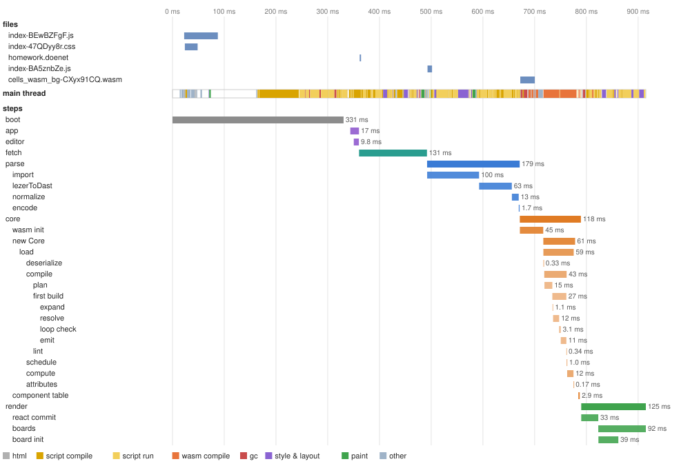
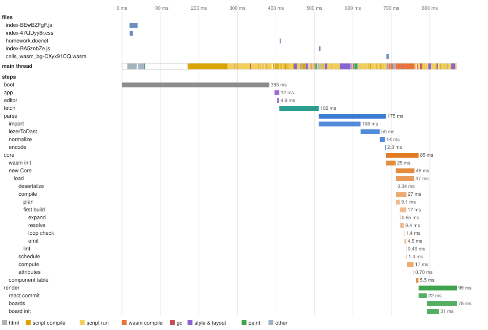
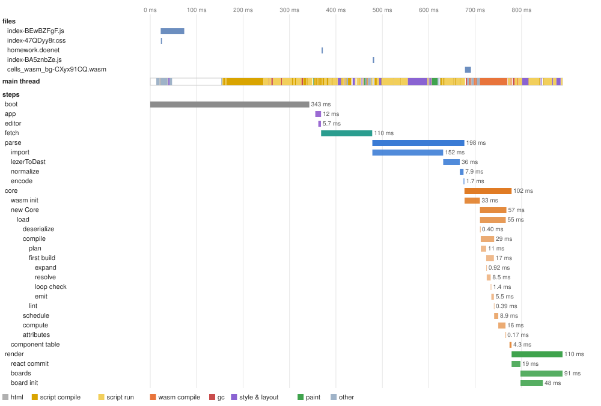
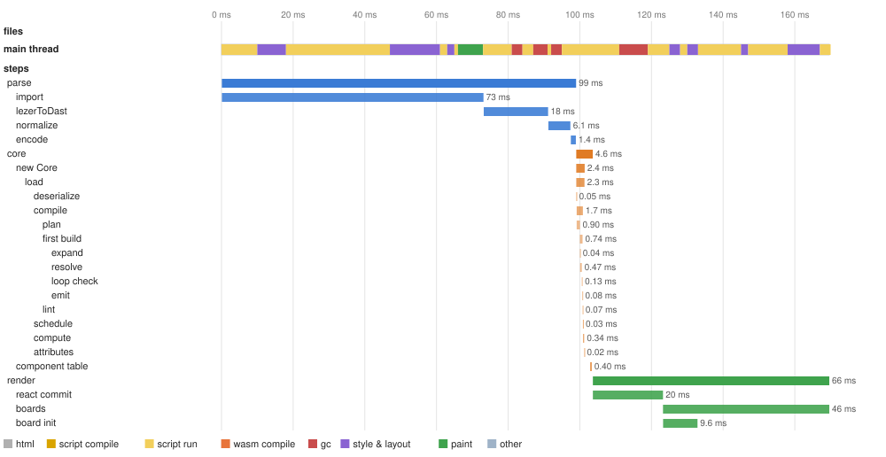

# Load trace: 2026-10-21-claude-cloud-aa2a40e47

Machine **claude-cloud** (Intel(R) Xeon(R) Processor @ 2.80GHz, 4 cores, 16093 MB, Linux 6.18.44-fc-v139 x64, Node v22.22.0); commit `aa2a40e47`; 2026-10-21.

Builds: cells: wasm-pack --release (npm run build -w packages/cells-core).

What the cells viewer does to get from DoenetML text to the first render, step by step, in the order it does it, and what the browser does underneath. Each scenario loads the page by navigation from the viewer's build, served as a host would serve it, and ends at the first render (the `render` step's end). Step times are medians of 5 runs. The figures are of one more run made under a Chrome performance trace, which slows the page somewhat, so their times run a little above the tables'. A step's name is its path: `parse/lezerToDast` is part of `parse`. What every step does, and where its code is, is under [Steps](#steps). How the layer works: [METHOD.md](../../../METHOD.md#the-trace-layer).

## First render

Navigation (or, for `edit`, the Refresh) to the first render, median; under it the fastest and slowest run.

| Scenario (homework) | CPU ×1 |
|---|---|
| editor page, cold | **927 ms** 823 ms–1.02 s |
| editor page, warm | **863 ms** 814 ms–896 ms |
| editor page, hot | **930 ms** 819 ms–961 ms |
| editor page, edit | **160 ms** 153 ms–204 ms |
| viewer page, cold | **594 ms** 556 ms–622 ms |
| viewer page, warm | **561 ms** 557 ms–597 ms |
| viewer page, hot | **594 ms** 562 ms–639 ms |
| viewer page, edit | **71 ms** 60 ms–75 ms |

- **cold**: a first visit: a new browser profile, nothing cached.
- **warm**: a second visit: the files in the HTTP cache; Chromium caches compiled code for the larger scripts during this visit.
- **hot**: a third visit: the first that could use that compiled code (whether it did shows in script compile, under The main thread by kind of work).
- **edit**: the open page given a changed document, as the editor's Refresh does.

## editor page, cold, CPU ×1

A first visit: a new browser profile, nothing cached. First render **927 ms**.

The traced run: first render 915 ms. Top: the files the page fetched (from the cache when the tooltip says so). Middle: what the main thread did, by kind. Bottom: the steps. Hover a bar for its numbers.

| Step | Starts at | Takes | Work |
|---|---|---|---|
| boot | 0.00 ms | 352 ms |  |
| app | 360 ms | 15 ms |  |
| editor | 369 ms | 7.0 ms |  |
| fetch | 378 ms | 125 ms | 3,922 chars |
| parse | 527 ms | 168 ms | 3,922 chars |
| &nbsp;&nbsp;import | 527 ms | 107 ms |  |
| &nbsp;&nbsp;lezerToDast | 625 ms | 43 ms | 3,922 chars |
| &nbsp;&nbsp;normalize | 668 ms | 15 ms |  |
| &nbsp;&nbsp;encode | 687 ms | 3.4 ms |  |
| core | 695 ms | 121 ms |  |
| &nbsp;&nbsp;wasm init | 695 ms | 65 ms |  |
| &nbsp;&nbsp;new Core | 756 ms | 49 ms | 12,920 bytes |
| &nbsp;&nbsp;&nbsp;&nbsp;load | 756 ms | 47 ms |  |
| &nbsp;&nbsp;&nbsp;&nbsp;&nbsp;&nbsp;deserialize | 756 ms | 0.43 ms | 12,920 bytes, 379 dast nodes |
| &nbsp;&nbsp;&nbsp;&nbsp;&nbsp;&nbsp;compile | 758 ms | 30 ms |  |
| &nbsp;&nbsp;&nbsp;&nbsp;&nbsp;&nbsp;&nbsp;&nbsp;plan | 758 ms | 14 ms | 122 elements, 2 templates |
| &nbsp;&nbsp;&nbsp;&nbsp;&nbsp;&nbsp;&nbsp;&nbsp;first build | 772 ms | 15 ms |  |
| &nbsp;&nbsp;&nbsp;&nbsp;&nbsp;&nbsp;&nbsp;&nbsp;&nbsp;&nbsp;expand | 772 ms | 0.64 ms |  |
| &nbsp;&nbsp;&nbsp;&nbsp;&nbsp;&nbsp;&nbsp;&nbsp;&nbsp;&nbsp;resolve | 773 ms | 6.5 ms |  |
| &nbsp;&nbsp;&nbsp;&nbsp;&nbsp;&nbsp;&nbsp;&nbsp;&nbsp;&nbsp;loop check | 781 ms | 1.6 ms |  |
| &nbsp;&nbsp;&nbsp;&nbsp;&nbsp;&nbsp;&nbsp;&nbsp;&nbsp;&nbsp;emit | 782 ms | 5.7 ms | 467 cells, 124 components, 95 instructions |
| &nbsp;&nbsp;&nbsp;&nbsp;&nbsp;&nbsp;&nbsp;&nbsp;lint | 788 ms | 0.51 ms |  |
| &nbsp;&nbsp;&nbsp;&nbsp;&nbsp;&nbsp;schedule | 788 ms | 0.98 ms | 95 instructions |
| &nbsp;&nbsp;&nbsp;&nbsp;&nbsp;&nbsp;compute | 789 ms | 13 ms | 467 cells |
| &nbsp;&nbsp;&nbsp;&nbsp;&nbsp;&nbsp;attributes | 802 ms | 0.18 ms |  |
| &nbsp;&nbsp;component table | 809 ms | 1.8 ms | 124 components |
| render | 811 ms | 115 ms | 124 components, 1,615 elements |
| &nbsp;&nbsp;react commit | 811 ms | 28 ms | 124 components |
| &nbsp;&nbsp;boards | 840 ms | 85 ms | 1 boards |
| &nbsp;&nbsp;board init | 840 ms | 35 ms |  |

The main thread in the traced run, by kind of work (other threads' work is not counted; see below):

| Kind | Time | Share | What it is |
|---|---|---|---|
| html | 5.7 ms | 1% | parsing the HTML |
| script compile | 219 ms | 24% | V8 parsing and compiling JavaScript (including lazy compiles of functions on their first call) |
| script run | 311 ms | 34% | running JavaScript: the page's code, React, the parser, JSXGraph |
| wasm compile | 76 ms | 8% | compiling WebAssembly (eager validation, and lazy compiles of functions on their first call) |
| gc | 27 ms | 3% | garbage collection |
| style & layout | 76 ms | 8% | computing styles and laying out the page |
| paint | 16 ms | 2% | painting and handing the frame to the compositor |
| other | 58 ms | 6% | the browser's own task handling and work of no kind above (loading, messages) |
| idle | 126 ms | 14% | waiting: for the network, a timer or the next frame |

## editor page, warm, CPU ×1

A second visit: the files in the HTTP cache; Chromium caches compiled code for the larger scripts during this visit. First render **863 ms**.

The traced run: first render 870 ms. Top: the files the page fetched (from the cache when the tooltip says so). Middle: what the main thread did, by kind. Bottom: the steps. Hover a bar for its numbers.

| Step | Starts at | Takes | Work |
|---|---|---|---|
| boot | 0.00 ms | 337 ms |  |
| app | 345 ms | 12 ms |  |
| editor | 350 ms | 4.7 ms |  |
| fetch | 355 ms | 113 ms | 3,922 chars |
| parse | 470 ms | 168 ms | 3,922 chars |
| &nbsp;&nbsp;import | 470 ms | 96 ms |  |
| &nbsp;&nbsp;lezerToDast | 567 ms | 49 ms | 3,922 chars |
| &nbsp;&nbsp;normalize | 616 ms | 12 ms |  |
| &nbsp;&nbsp;encode | 625 ms | 3.3 ms |  |
| core | 631 ms | 111 ms |  |
| &nbsp;&nbsp;wasm init | 632 ms | 42 ms |  |
| &nbsp;&nbsp;new Core | 681 ms | 55 ms | 12,920 bytes |
| &nbsp;&nbsp;&nbsp;&nbsp;load | 681 ms | 53 ms |  |
| &nbsp;&nbsp;&nbsp;&nbsp;&nbsp;&nbsp;deserialize | 681 ms | 0.43 ms | 12,920 bytes, 379 dast nodes |
| &nbsp;&nbsp;&nbsp;&nbsp;&nbsp;&nbsp;compile | 684 ms | 36 ms |  |
| &nbsp;&nbsp;&nbsp;&nbsp;&nbsp;&nbsp;&nbsp;&nbsp;plan | 684 ms | 14 ms | 122 elements, 2 templates |
| &nbsp;&nbsp;&nbsp;&nbsp;&nbsp;&nbsp;&nbsp;&nbsp;first build | 698 ms | 19 ms |  |
| &nbsp;&nbsp;&nbsp;&nbsp;&nbsp;&nbsp;&nbsp;&nbsp;&nbsp;&nbsp;expand | 699 ms | 0.93 ms |  |
| &nbsp;&nbsp;&nbsp;&nbsp;&nbsp;&nbsp;&nbsp;&nbsp;&nbsp;&nbsp;resolve | 700 ms | 10 ms |  |
| &nbsp;&nbsp;&nbsp;&nbsp;&nbsp;&nbsp;&nbsp;&nbsp;&nbsp;&nbsp;loop check | 716 ms | 1.3 ms |  |
| &nbsp;&nbsp;&nbsp;&nbsp;&nbsp;&nbsp;&nbsp;&nbsp;&nbsp;&nbsp;emit | 716 ms | 4.0 ms | 467 cells, 124 components, 95 instructions |
| &nbsp;&nbsp;&nbsp;&nbsp;&nbsp;&nbsp;&nbsp;&nbsp;lint | 719 ms | 0.30 ms |  |
| &nbsp;&nbsp;&nbsp;&nbsp;&nbsp;&nbsp;schedule | 720 ms | 0.85 ms | 95 instructions |
| &nbsp;&nbsp;&nbsp;&nbsp;&nbsp;&nbsp;compute | 721 ms | 14 ms | 467 cells |
| &nbsp;&nbsp;&nbsp;&nbsp;&nbsp;&nbsp;attributes | 732 ms | 0.25 ms |  |
| &nbsp;&nbsp;component table | 740 ms | 1.7 ms | 124 components |
| render | 742 ms | 121 ms | 124 components, 1,615 elements |
| &nbsp;&nbsp;react commit | 742 ms | 30 ms | 124 components |
| &nbsp;&nbsp;boards | 772 ms | 89 ms | 1 boards |
| &nbsp;&nbsp;board init | 772 ms | 36 ms |  |

The main thread in the traced run, by kind of work (other threads' work is not counted; see below):

| Kind | Time | Share | What it is |
|---|---|---|---|
| html | 14 ms | 2% | parsing the HTML |
| script compile | 210 ms | 24% | V8 parsing and compiling JavaScript (including lazy compiles of functions on their first call) |
| script run | 299 ms | 34% | running JavaScript: the page's code, React, the parser, JSXGraph |
| wasm compile | 55 ms | 6% | compiling WebAssembly (eager validation, and lazy compiles of functions on their first call) |
| gc | 16 ms | 2% | garbage collection |
| style & layout | 79 ms | 9% | computing styles and laying out the page |
| paint | 14 ms | 2% | painting and handing the frame to the compositor |
| other | 54 ms | 6% | the browser's own task handling and work of no kind above (loading, messages) |
| idle | 129 ms | 15% | waiting: for the network, a timer or the next frame |

## editor page, hot, CPU ×1

A third visit: the first that could use that compiled code (whether it did shows in script compile, under The main thread by kind of work). First render **930 ms**.

The traced run: first render 888 ms. Top: the files the page fetched (from the cache when the tooltip says so). Middle: what the main thread did, by kind. Bottom: the steps. Hover a bar for its numbers.

| Step | Starts at | Takes | Work |
|---|---|---|---|
| boot | 0.00 ms | 341 ms |  |
| app | 350 ms | 12 ms |  |
| editor | 355 ms | 5.2 ms |  |
| fetch | 360 ms | 116 ms | 3,922 chars |
| parse | 467 ms | 177 ms | 3,922 chars |
| &nbsp;&nbsp;import | 467 ms | 106 ms |  |
| &nbsp;&nbsp;lezerToDast | 573 ms | 54 ms | 3,922 chars |
| &nbsp;&nbsp;normalize | 628 ms | 12 ms |  |
| &nbsp;&nbsp;encode | 641 ms | 2.5 ms |  |
| core | 644 ms | 136 ms |  |
| &nbsp;&nbsp;wasm init | 644 ms | 48 ms |  |
| &nbsp;&nbsp;new Core | 715 ms | 74 ms | 12,920 bytes |
| &nbsp;&nbsp;&nbsp;&nbsp;load | 716 ms | 67 ms |  |
| &nbsp;&nbsp;&nbsp;&nbsp;&nbsp;&nbsp;deserialize | 716 ms | 0.45 ms | 12,920 bytes, 379 dast nodes |
| &nbsp;&nbsp;&nbsp;&nbsp;&nbsp;&nbsp;compile | 717 ms | 40 ms |  |
| &nbsp;&nbsp;&nbsp;&nbsp;&nbsp;&nbsp;&nbsp;&nbsp;plan | 717 ms | 15 ms | 122 elements, 2 templates |
| &nbsp;&nbsp;&nbsp;&nbsp;&nbsp;&nbsp;&nbsp;&nbsp;first build | 732 ms | 20 ms |  |
| &nbsp;&nbsp;&nbsp;&nbsp;&nbsp;&nbsp;&nbsp;&nbsp;&nbsp;&nbsp;expand | 732 ms | 0.90 ms |  |
| &nbsp;&nbsp;&nbsp;&nbsp;&nbsp;&nbsp;&nbsp;&nbsp;&nbsp;&nbsp;resolve | 733 ms | 10 ms |  |
| &nbsp;&nbsp;&nbsp;&nbsp;&nbsp;&nbsp;&nbsp;&nbsp;&nbsp;&nbsp;loop check | 743 ms | 1.2 ms |  |
| &nbsp;&nbsp;&nbsp;&nbsp;&nbsp;&nbsp;&nbsp;&nbsp;&nbsp;&nbsp;emit | 745 ms | 7.2 ms | 467 cells, 124 components, 95 instructions |
| &nbsp;&nbsp;&nbsp;&nbsp;&nbsp;&nbsp;&nbsp;&nbsp;lint | 757 ms | 0.44 ms |  |
| &nbsp;&nbsp;&nbsp;&nbsp;&nbsp;&nbsp;schedule | 757 ms | 1.8 ms | 95 instructions |
| &nbsp;&nbsp;&nbsp;&nbsp;&nbsp;&nbsp;compute | 758 ms | 22 ms | 467 cells |
| &nbsp;&nbsp;&nbsp;&nbsp;&nbsp;&nbsp;attributes | 770 ms | 0.25 ms |  |
| &nbsp;&nbsp;component table | 776 ms | 4.0 ms | 124 components |
| render | 778 ms | 102 ms | 124 components, 1,615 elements |
| &nbsp;&nbsp;react commit | 778 ms | 23 ms | 124 components |
| &nbsp;&nbsp;boards | 812 ms | 76 ms | 1 boards |
| &nbsp;&nbsp;board init | 813 ms | 30 ms |  |

The main thread in the traced run, by kind of work (other threads' work is not counted; see below):

| Kind | Time | Share | What it is |
|---|---|---|---|
| html | 7.4 ms | 1% | parsing the HTML |
| script compile | 197 ms | 22% | V8 parsing and compiling JavaScript (including lazy compiles of functions on their first call) |
| script run | 300 ms | 34% | running JavaScript: the page's code, React, the parser, JSXGraph |
| wasm compile | 65 ms | 7% | compiling WebAssembly (eager validation, and lazy compiles of functions on their first call) |
| gc | 19 ms | 2% | garbage collection |
| style & layout | 102 ms | 12% | computing styles and laying out the page |
| paint | 17 ms | 2% | painting and handing the frame to the compositor |
| other | 58 ms | 7% | the browser's own task handling and work of no kind above (loading, messages) |
| idle | 123 ms | 14% | waiting: for the network, a timer or the next frame |

## editor page, edit, CPU ×1

The open page given a changed document, as the editor's Refresh does. First render **160 ms**.

The traced run: first render 170 ms. Top: the files the page fetched (from the cache when the tooltip says so). Middle: what the main thread did, by kind. Bottom: the steps. Hover a bar for its numbers.

| Step | Starts at | Takes | Work |
|---|---|---|---|
| parse | 0.08 ms | 90 ms | 3,938 chars |
| &nbsp;&nbsp;import | 0.08 ms | 74 ms |  |
| &nbsp;&nbsp;lezerToDast | 74 ms | 13 ms | 3,938 chars |
| &nbsp;&nbsp;normalize | 86 ms | 4.9 ms |  |
| &nbsp;&nbsp;encode | 89 ms | 0.94 ms |  |
| core | 90 ms | 3.8 ms |  |
| &nbsp;&nbsp;new Core | 90 ms | 1.9 ms | 13,004 bytes |
| &nbsp;&nbsp;&nbsp;&nbsp;load | 90 ms | 1.9 ms |  |
| &nbsp;&nbsp;&nbsp;&nbsp;&nbsp;&nbsp;deserialize | 90 ms | 0.04 ms | 13,004 bytes, 382 dast nodes |
| &nbsp;&nbsp;&nbsp;&nbsp;&nbsp;&nbsp;compile | 90 ms | 1.4 ms |  |
| &nbsp;&nbsp;&nbsp;&nbsp;&nbsp;&nbsp;&nbsp;&nbsp;plan | 90 ms | 0.71 ms | 123 elements, 2 templates |
| &nbsp;&nbsp;&nbsp;&nbsp;&nbsp;&nbsp;&nbsp;&nbsp;first build | 91 ms | 0.55 ms |  |
| &nbsp;&nbsp;&nbsp;&nbsp;&nbsp;&nbsp;&nbsp;&nbsp;&nbsp;&nbsp;expand | 91 ms | 0.03 ms |  |
| &nbsp;&nbsp;&nbsp;&nbsp;&nbsp;&nbsp;&nbsp;&nbsp;&nbsp;&nbsp;resolve | 91 ms | 0.31 ms |  |
| &nbsp;&nbsp;&nbsp;&nbsp;&nbsp;&nbsp;&nbsp;&nbsp;&nbsp;&nbsp;loop check | 91 ms | 0.13 ms |  |
| &nbsp;&nbsp;&nbsp;&nbsp;&nbsp;&nbsp;&nbsp;&nbsp;&nbsp;&nbsp;emit | 91 ms | 0.08 ms | 467 cells, 125 components, 95 instructions |
| &nbsp;&nbsp;&nbsp;&nbsp;&nbsp;&nbsp;&nbsp;&nbsp;lint | 91 ms | 0.06 ms |  |
| &nbsp;&nbsp;&nbsp;&nbsp;&nbsp;&nbsp;schedule | 91 ms | 0.02 ms | 95 instructions |
| &nbsp;&nbsp;&nbsp;&nbsp;&nbsp;&nbsp;compute | 91 ms | 0.25 ms | 467 cells |
| &nbsp;&nbsp;&nbsp;&nbsp;&nbsp;&nbsp;attributes | 92 ms | 0.01 ms |  |
| &nbsp;&nbsp;component table | 92 ms | 0.34 ms | 125 components |
| render | 93 ms | 67 ms | 125 components, 1,642 elements |
| &nbsp;&nbsp;react commit | 93 ms | 23 ms | 125 components |
| &nbsp;&nbsp;boards | 116 ms | 44 ms | 1 boards |
| &nbsp;&nbsp;board init | 116 ms | 11 ms |  |

The main thread in the traced run, by kind of work (other threads' work is not counted; see below):

| Kind | Time | Share | What it is |
|---|---|---|---|
| html | 0.07 ms | 0% | parsing the HTML |
| script compile | 4.8 ms | 3% | V8 parsing and compiling JavaScript (including lazy compiles of functions on their first call) |
| script run | 100 ms | 59% | running JavaScript: the page's code, React, the parser, JSXGraph |
| wasm compile | 0.21 ms | 0% | compiling WebAssembly (eager validation, and lazy compiles of functions on their first call) |
| gc | 17 ms | 10% | garbage collection |
| style & layout | 39 ms | 23% | computing styles and laying out the page |
| paint | 6.8 ms | 4% | painting and handing the frame to the compositor |
| other | 1.2 ms | 1% | the browser's own task handling and work of no kind above (loading, messages) |
| idle | 0.21 ms | 0% | waiting: for the network, a timer or the next frame |

## Visits compared: editor page, CPU ×1

The same document on each visit. A step that shrinks from cold to hot was paying for something the browser caches (files, compiled code); one that does not is work done on every load. A step can also take longer only because the main thread was busy with something else when it was due: compare the main-thread lanes in the figures above.

| Step | cold | warm | hot | edit |
|---|---|---|---|---|
| boot | 352 ms | 337 ms | 341 ms | 0.00 ms |
| app | 15 ms | 12 ms | 12 ms | 0.00 ms |
| editor | 7.0 ms | 4.7 ms | 5.2 ms | 0.00 ms |
| fetch | 125 ms | 113 ms | 116 ms | 0.00 ms |
| parse | 168 ms | 168 ms | 177 ms | 90 ms |
| &nbsp;&nbsp;import | 107 ms | 96 ms | 106 ms | 74 ms |
| &nbsp;&nbsp;lezerToDast | 43 ms | 49 ms | 54 ms | 13 ms |
| &nbsp;&nbsp;normalize | 15 ms | 12 ms | 12 ms | 4.9 ms |
| &nbsp;&nbsp;encode | 3.4 ms | 3.3 ms | 2.5 ms | 0.94 ms |
| core | 121 ms | 111 ms | 136 ms | 3.8 ms |
| &nbsp;&nbsp;wasm init | 65 ms | 42 ms | 48 ms | 0.00 ms |
| &nbsp;&nbsp;new Core | 49 ms | 55 ms | 74 ms | 1.9 ms |
| &nbsp;&nbsp;component table | 1.8 ms | 1.7 ms | 4.0 ms | 0.34 ms |
| render | 115 ms | 121 ms | 102 ms | 67 ms |
| &nbsp;&nbsp;react commit | 28 ms | 30 ms | 23 ms | 23 ms |
| &nbsp;&nbsp;boards | 85 ms | 89 ms | 76 ms | 44 ms |
| &nbsp;&nbsp;board init | 35 ms | 36 ms | 30 ms | 11 ms |
| **first render** | **927 ms** | **863 ms** | **930 ms** | **160 ms** |

## The editor page and the viewer alone, cold, CPU ×1

Both load the same bundle; the viewer alone (`?editor=0`) does not mount the editor. The difference is what mounting the editor costs a load.

| Step | editor | viewer |
|---|---|---|
| boot | 352 ms | 328 ms |
| app | 15 ms | 7.3 ms |
| editor | 7.0 ms | 0.00 ms |
| fetch | 125 ms | 26 ms |
| parse | 168 ms | 53 ms |
| &nbsp;&nbsp;import | 107 ms | 15 ms |
| &nbsp;&nbsp;lezerToDast | 43 ms | 26 ms |
| &nbsp;&nbsp;normalize | 15 ms | 7.7 ms |
| &nbsp;&nbsp;encode | 3.4 ms | 1.6 ms |
| core | 121 ms | 85 ms |
| &nbsp;&nbsp;wasm init | 65 ms | 35 ms |
| &nbsp;&nbsp;new Core | 49 ms | 42 ms |
| &nbsp;&nbsp;component table | 1.8 ms | 2.1 ms |
| render | 115 ms | 83 ms |
| &nbsp;&nbsp;react commit | 28 ms | 20 ms |
| &nbsp;&nbsp;boards | 85 ms | 64 ms |
| &nbsp;&nbsp;board init | 35 ms | 30 ms |
| **first render** | **927 ms** | **594 ms** |

## The main thread by kind of work

Every traced run of `homework`, from its start to its first render. Each millisecond is given to the innermost trace event covering it (`src/chrome-trace.mjs`). Only the main thread: work on other threads (a script compiled while it streams in, wasm optimized in the background, the editor's language server in its worker) is not here, and shows as idle when the main thread waits on it.

| Scenario | html | script compile | script run | wasm compile | gc | style & layout | paint | other | idle | first render (traced) |
|---|---|---|---|---|---|---|---|---|---|---|
| editor, cold, CPU ×1 | 5.7 ms | 219 ms | 311 ms | 76 ms | 27 ms | 76 ms | 16 ms | 58 ms | 126 ms | 915 ms |
| editor, warm, CPU ×1 | 14 ms | 210 ms | 299 ms | 55 ms | 16 ms | 79 ms | 14 ms | 54 ms | 129 ms | 870 ms |
| editor, hot, CPU ×1 | 7.4 ms | 197 ms | 300 ms | 65 ms | 19 ms | 102 ms | 17 ms | 58 ms | 123 ms | 888 ms |
| editor, edit, CPU ×1 | 0.07 ms | 4.8 ms | 100 ms | 0.21 ms | 17 ms | 39 ms | 6.8 ms | 1.2 ms | 0.21 ms | 170 ms |
| viewer, cold, CPU ×1 | 13 ms | 178 ms | 213 ms | 65 ms | 13 ms | 17 ms | 5.0 ms | 61 ms | 114 ms | 678 ms |
| viewer, warm, CPU ×1 | 12 ms | 148 ms | 183 ms | 54 ms | 9.8 ms | 21 ms | 2.2 ms | 49 ms | 101 ms | 582 ms |
| viewer, hot, CPU ×1 | 5.8 ms | 148 ms | 213 ms | 53 ms | 24 ms | 17 ms | 3.0 ms | 49 ms | 142 ms | 655 ms |
| viewer, edit, CPU ×1 | 0.10 ms | 6.3 ms | 61 ms | 0.13 ms | 3.0 ms | 6.2 ms | 0.00 ms | 0.88 ms | 0.10 ms | 78 ms |

## Steps

In the order a load runs them. Indented steps are part of the step above. The stages of a build (expand, resolve, loop check, emit) run inside whichever step builds: the compile's check, or a later build pass.

| Step | What it does | Where |
|---|---|---|
| `boot` | From navigation until the page's own code starts: the HTML, then downloading, parsing, compiling and running every eagerly loaded script (React, JSXGraph, CodeMirror with the language server's source, the viewer). Nothing about the document has happened yet. Much of a script's compiling happens on a background thread while it downloads (streaming), which is why the main thread can sit idle during boot. | `packages/cells-viewer/dev/main.tsx (top of the module)` |
| `app` | React's first render of the page around the document: the toolbar and the editor beside an empty viewer, until its effects have run. | `packages/cells-viewer/dev/main.tsx (App)` |
| `editor` | The editor's first mount (CodeMirror), part of `app`. | `packages/cells-viewer/src/EditorViewer.tsx` |
| `fetch` | The DoenetML text requested from its URL, until the page handles the response. The network part is in the file lane; the rest is waiting for the main thread. | `packages/cells-viewer/dev/main.tsx (?src=)` |
| `parse` | DoenetML text to the bytes the core reads. | `packages/cells-viewer/src/parse.ts` |
| &nbsp;&nbsp;`import` | The parser's code (@doenet/parser), a separate chunk loaded the first time a page parses. | `packages/cells-viewer/src/parse.ts` |
| &nbsp;&nbsp;`lezerToDast` | The text parsed by the Lezer grammar into a syntax tree, then converted to a DAST (the document as a tree of elements, text and references). | `packages/parser/src/lezer-to-dast` |
| &nbsp;&nbsp;`normalize` | The DAST put in the shape the core expects: one <document> root, comments and XML-only nodes removed, component sugar expanded. | `packages/parser/src/dast-normalize/normalize-dast.ts` |
| &nbsp;&nbsp;`encode` | The DAST encoded in the core's binary wire format (ADR 0002). | `packages/cells-core/scripts/cdast-encode.mjs` |
| `core` | The bytes to a loaded core whose cells the renderer can read. | `packages/cells-viewer/src/core.ts (loadDocument)` |
| &nbsp;&nbsp;`wasm init` | The core's wasm fetched, compiled and instantiated: once per page, on its first load. The wasm is compiled lazily, function by function, the first time each runs, so much of its compiling lands in `core/new Core`. | `packages/cells-viewer/src/core.ts` |
| &nbsp;&nbsp;`new Core` | The call into the core: its bytes are copied into wasm memory, then the load below runs. Time here and not in `load` is the copy and the call. | `packages/cells-core/crates/cells-wasm/src/lib.rs (Core::new)` |
| &nbsp;&nbsp;&nbsp;&nbsp;`load` | The core's load: compile once, then build until the structure settles (ADR 0015). | `packages/cells-core/crates/cells-core/src/document/load.rs` |
| &nbsp;&nbsp;&nbsp;&nbsp;&nbsp;&nbsp;`deserialize` | The wire format read into the core's DAST, in flat columns. | `packages/cells-core/crates/cells-core/src/dast/` |
| &nbsp;&nbsp;&nbsp;&nbsp;&nbsp;&nbsp;`compile` | Everything that depends only on the source, done once: plan, check, lint (ADR 0015). | `packages/cells-core/crates/cells-core/src/compile/check.rs` |
| &nbsp;&nbsp;&nbsp;&nbsp;&nbsp;&nbsp;&nbsp;&nbsp;`plan` | Every element planned by its type's planner into templates: where each prop's value comes from, every reference, every choice. Math text is parsed into expression trees here, once. | `packages/cells-core/crates/cells-core/src/compile/mod.rs, compile/planner.rs` |
| &nbsp;&nbsp;&nbsp;&nbsp;&nbsp;&nbsp;&nbsp;&nbsp;`probe` | Only with a repeat or a select: one build through the probe, which stands for every iteration count and every pick, to find every cycle and error the document can have. Discarded afterwards (ADR 0012, ADR 0014). | `packages/cells-core/crates/cells-core/src/build/probe.rs` |
| &nbsp;&nbsp;&nbsp;&nbsp;&nbsp;&nbsp;&nbsp;&nbsp;`first build` | Without a repeat or a select: the document's one build, which is also its check (the probe's loop check runs in it). The load keeps it instead of building again. | `packages/cells-core/crates/cells-core/src/build/mod.rs (first_build)` |
| &nbsp;&nbsp;&nbsp;&nbsp;&nbsp;&nbsp;&nbsp;&nbsp;`lint` | The accessibility rules, one walk over the DAST. | `packages/cells-core/crates/cells-core/src/compile/lint.rs` |
| &nbsp;&nbsp;&nbsp;&nbsp;&nbsp;&nbsp;`build` | A further build pass, when a repeat's count, computed by the pass before, differs from the count it was stamped with. | `packages/cells-core/crates/cells-core/src/build/mod.rs (build)` |
| &nbsp;&nbsp;&nbsp;&nbsp;&nbsp;&nbsp;`schedule` | The instructions sorted so each runs after the cells it reads. | `packages/cells-core/crates/cells-core/src/program/mod.rs (Program::schedule)` |
| &nbsp;&nbsp;&nbsp;&nbsp;&nbsp;&nbsp;`compute` | Every derived cell computed once: the document's first state. | `packages/cells-core/crates/cells-core/src/document/mod.rs (recompute), program/` |
| &nbsp;&nbsp;&nbsp;&nbsp;&nbsp;&nbsp;`attributes` | The source's literal attributes kept for the renderer (sizes, styles, text it shows as written). | `packages/cells-core/crates/cells-core/src/dast/attrs.rs` |
| &nbsp;&nbsp;`component table` | Views over wasm memory through which the renderer reads components and their cells without copying. | `packages/cells-viewer/src/components.ts` |
| `render` | From handing the loaded core to React until the first commit and every board drawn: the first render. | `packages/cells-viewer/src/document.ts (openDocument)` |
| &nbsp;&nbsp;`react commit` | React renders the component tree and commits it to the DOM. | `packages/cells-viewer/src/renderers/` |
| &nbsp;&nbsp;`board init` | One JSXGraph board created (axes, grid, navigation bar). | `packages/cells-viewer/src/renderers/jsxgraph/Board.tsx` |
| &nbsp;&nbsp;`boards` | From the commit to the boards' last redraw: a board's elements are created a commit after the board and drawn together. | `packages/cells-viewer/src/renderers/jsxgraph/` |
| (a build's) `expand` | Each template stamped into components, once per scope (each repeat iteration is a scope). | `packages/cells-core/crates/cells-core/src/build/expand/` |
| (a build's) `resolve` | Every reference resolved to the slot it names. | `packages/cells-core/crates/cells-core/src/build/expand/mod.rs (resolve_all)` |
| (a build's) `loop check` | The probe's checks that no dependency loop closes, at any count. | `packages/cells-core/crates/cells-core/src/build/probe.rs` |
| (a build's) `emit` | Aliased slots merged into cells, cells numbered (essential, fixed, derived), operators bound into instructions. | `packages/cells-core/crates/cells-core/src/build/emit.rs` |
