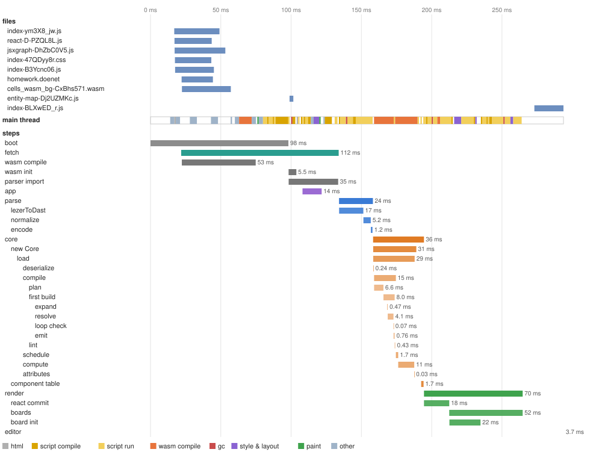
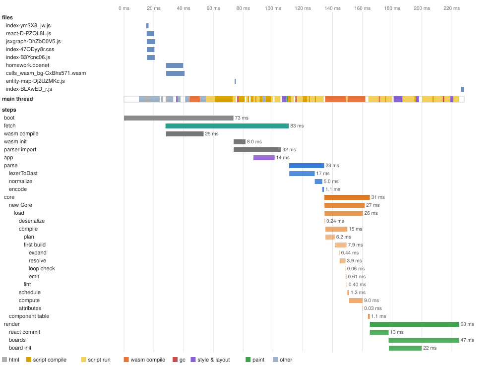
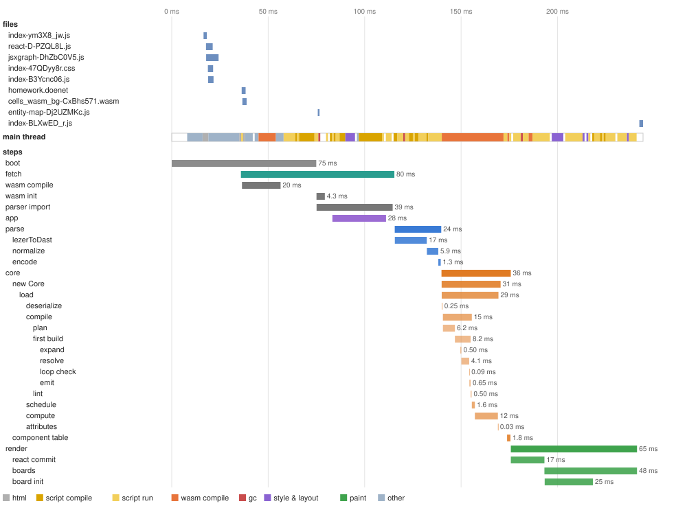
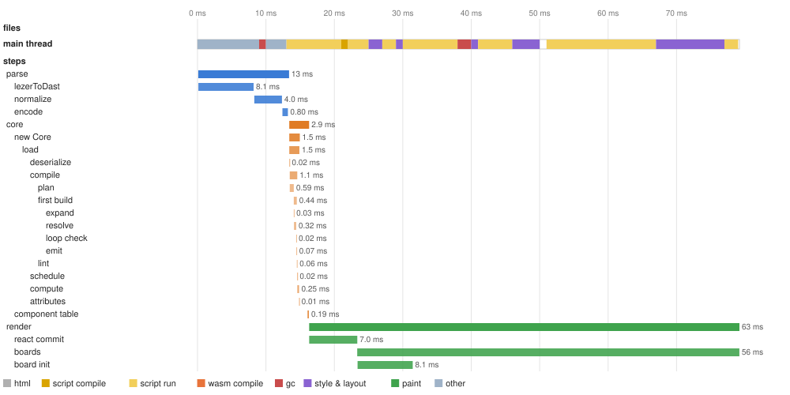

# Load trace: 2026-10-22-claude-cloud-bbcd457

Machine **claude-cloud** (Intel(R) Xeon(R) Processor, 4 cores, 16091 MB, Linux 6.18.44-fc-v140 x64, Node v22.22.0); commit `bbcd457`; 2026-10-22.

Builds: cells: wasm-pack --release (npm run build -w packages/cells-core), wasm-opt -O from binaryen 117 on the PATH.

What the cells viewer does to get from DoenetML text to the first render, step by step, in the order it does it, and what the browser does underneath. Each scenario loads the page by navigation from the viewer's build, served as a host would serve it, and ends at the first render (the `render` step's end). Step times are medians of 5 runs. The figures are of one more run made under a Chrome performance trace, which slows the page somewhat, so their times run a little above the tables'. A step's name is its path: `parse/lezerToDast` is part of `parse`. What every step does, and where its code is, is under [Steps](#steps). How the layer works: [METHOD.md](../../../METHOD.md#the-trace-layer).

## First render

Navigation (or, for `edit`, the Refresh) to the first render, median; under it the fastest and slowest run.

| Scenario (homework) | CPU ×1 | CPU ×4 |
|---|---|---|
| editor page, cold | **249 ms** 218 ms–320 ms | **810 ms** 741 ms–831 ms |
| editor page, warm | **222 ms** 207 ms–258 ms | **788 ms** 717 ms–820 ms |
| editor page, hot | **222 ms** 213 ms–228 ms | **768 ms** 731 ms–785 ms |
| editor page, edit | **76 ms** 70 ms–79 ms | **284 ms** 239 ms–295 ms |
| viewer page, cold | **231 ms** 214 ms–271 ms | **817 ms** 771 ms–875 ms |
| viewer page, warm | **225 ms** 212 ms–246 ms | **793 ms** 757 ms–837 ms |
| viewer page, hot | **203 ms** 198 ms–226 ms | **809 ms** 794 ms–833 ms |
| viewer page, edit | **33 ms** 31 ms–36 ms | **153 ms** 137 ms–163 ms |

- **cold**: a first visit: a new browser profile, nothing cached.
- **warm**: a second visit: the files in the HTTP cache; Chromium caches compiled code for the larger scripts during this visit.
- **hot**: a third visit: the first that could use that compiled code (whether it did shows in script compile, under The main thread by kind of work).
- **edit**: the open page given a changed document, as the editor's Refresh does.

## editor page, cold, CPU ×1

A first visit: a new browser profile, nothing cached. First render **249 ms**.

The traced run: first render 265 ms. Top: the files the page fetched (from the cache when the tooltip says so). Middle: what the main thread did, by kind. Bottom: the steps. Hover a bar for its numbers.

| Step | Starts at | Takes | Work |
|---|---|---|---|
| boot | 0.00 ms | 87 ms |  |
| fetch | 30 ms | 101 ms | 3,922 chars |
| wasm compile | 31 ms | 41 ms |  |
| wasm init | 87 ms | 3.5 ms | 1 precompiled |
| parser import | 87 ms | 29 ms |  |
| app | 94 ms | 15 ms |  |
| parse | 125 ms | 21 ms | 3,922 chars |
| &nbsp;&nbsp;lezerToDast | 125 ms | 16 ms | 3,922 chars |
| &nbsp;&nbsp;normalize | 141 ms | 4.6 ms |  |
| &nbsp;&nbsp;encode | 145 ms | 1.2 ms |  |
| core | 147 ms | 31 ms |  |
| &nbsp;&nbsp;new Core | 147 ms | 27 ms | 12,920 bytes |
| &nbsp;&nbsp;&nbsp;&nbsp;load | 147 ms | 26 ms |  |
| &nbsp;&nbsp;&nbsp;&nbsp;&nbsp;&nbsp;deserialize | 147 ms | 0.25 ms | 12,920 bytes, 379 dast nodes |
| &nbsp;&nbsp;&nbsp;&nbsp;&nbsp;&nbsp;compile | 147 ms | 14 ms |  |
| &nbsp;&nbsp;&nbsp;&nbsp;&nbsp;&nbsp;&nbsp;&nbsp;plan | 147 ms | 6.0 ms | 122 elements, 2 templates |
| &nbsp;&nbsp;&nbsp;&nbsp;&nbsp;&nbsp;&nbsp;&nbsp;first build | 156 ms | 7.1 ms |  |
| &nbsp;&nbsp;&nbsp;&nbsp;&nbsp;&nbsp;&nbsp;&nbsp;&nbsp;&nbsp;expand | 158 ms | 0.41 ms |  |
| &nbsp;&nbsp;&nbsp;&nbsp;&nbsp;&nbsp;&nbsp;&nbsp;&nbsp;&nbsp;resolve | 159 ms | 3.5 ms |  |
| &nbsp;&nbsp;&nbsp;&nbsp;&nbsp;&nbsp;&nbsp;&nbsp;&nbsp;&nbsp;loop check | 162 ms | 0.06 ms |  |
| &nbsp;&nbsp;&nbsp;&nbsp;&nbsp;&nbsp;&nbsp;&nbsp;&nbsp;&nbsp;emit | 162 ms | 0.44 ms | 467 cells, 124 components, 95 instructions |
| &nbsp;&nbsp;&nbsp;&nbsp;&nbsp;&nbsp;&nbsp;&nbsp;lint | 163 ms | 0.22 ms |  |
| &nbsp;&nbsp;&nbsp;&nbsp;&nbsp;&nbsp;schedule | 163 ms | 0.74 ms | 95 instructions |
| &nbsp;&nbsp;&nbsp;&nbsp;&nbsp;&nbsp;compute | 165 ms | 11 ms | 467 cells |
| &nbsp;&nbsp;&nbsp;&nbsp;&nbsp;&nbsp;attributes | 178 ms | 0.02 ms |  |
| &nbsp;&nbsp;component table | 181 ms | 1.1 ms | 124 components |
| render | 182 ms | 65 ms | 124 components, 381 elements |
| &nbsp;&nbsp;react commit | 182 ms | 12 ms | 124 components |
| &nbsp;&nbsp;boards | 193 ms | 49 ms | 1 boards |
| &nbsp;&nbsp;board init | 193 ms | 25 ms |  |
| editor | 427 ms | 35 ms |  |

The main thread in the traced run, by kind of work (other threads' work is not counted; see below):

| Kind | Time | Share | What it is |
|---|---|---|---|
| html | 3.7 ms | 1% | parsing the HTML |
| script compile | 50 ms | 19% | V8 parsing and compiling JavaScript (including lazy compiles of functions on their first call) |
| script run | 84 ms | 32% | running JavaScript: the page's code, React, the parser, JSXGraph |
| wasm compile | 38 ms | 14% | compiling WebAssembly (eager validation, and lazy compiles of functions on their first call) |
| gc | 3.8 ms | 1% | garbage collection |
| style & layout | 14 ms | 5% | computing styles and laying out the page |
| paint | 2.6 ms | 1% | painting and handing the frame to the compositor |
| other | 29 ms | 11% | the browser's own task handling and work of no kind above (loading, messages) |
| idle | 39 ms | 15% | waiting: for the network, a timer or the next frame |

## editor page, warm, CPU ×1

A second visit: the files in the HTTP cache; Chromium caches compiled code for the larger scripts during this visit. First render **222 ms**.

The traced run: first render 225 ms. Top: the files the page fetched (from the cache when the tooltip says so). Middle: what the main thread did, by kind. Bottom: the steps. Hover a bar for its numbers.

| Step | Starts at | Takes | Work |
|---|---|---|---|
| boot | 0.00 ms | 71 ms |  |
| fetch | 30 ms | 75 ms | 3,922 chars |
| wasm compile | 30 ms | 31 ms |  |
| wasm init | 72 ms | 4.4 ms | 1 precompiled |
| parser import | 72 ms | 23 ms |  |
| app | 78 ms | 15 ms |  |
| parse | 100 ms | 22 ms | 3,922 chars |
| &nbsp;&nbsp;lezerToDast | 100 ms | 16 ms | 3,922 chars |
| &nbsp;&nbsp;normalize | 118 ms | 4.4 ms |  |
| &nbsp;&nbsp;encode | 122 ms | 1.0 ms |  |
| core | 123 ms | 36 ms |  |
| &nbsp;&nbsp;new Core | 123 ms | 31 ms | 12,920 bytes |
| &nbsp;&nbsp;&nbsp;&nbsp;load | 123 ms | 29 ms |  |
| &nbsp;&nbsp;&nbsp;&nbsp;&nbsp;&nbsp;deserialize | 123 ms | 0.22 ms | 12,920 bytes, 379 dast nodes |
| &nbsp;&nbsp;&nbsp;&nbsp;&nbsp;&nbsp;compile | 124 ms | 14 ms |  |
| &nbsp;&nbsp;&nbsp;&nbsp;&nbsp;&nbsp;&nbsp;&nbsp;plan | 124 ms | 5.8 ms | 122 elements, 2 templates |
| &nbsp;&nbsp;&nbsp;&nbsp;&nbsp;&nbsp;&nbsp;&nbsp;first build | 130 ms | 7.4 ms |  |
| &nbsp;&nbsp;&nbsp;&nbsp;&nbsp;&nbsp;&nbsp;&nbsp;&nbsp;&nbsp;expand | 137 ms | 0.44 ms |  |
| &nbsp;&nbsp;&nbsp;&nbsp;&nbsp;&nbsp;&nbsp;&nbsp;&nbsp;&nbsp;resolve | 137 ms | 3.7 ms |  |
| &nbsp;&nbsp;&nbsp;&nbsp;&nbsp;&nbsp;&nbsp;&nbsp;&nbsp;&nbsp;loop check | 141 ms | 0.05 ms |  |
| &nbsp;&nbsp;&nbsp;&nbsp;&nbsp;&nbsp;&nbsp;&nbsp;&nbsp;&nbsp;emit | 141 ms | 0.57 ms | 467 cells, 124 components, 95 instructions |
| &nbsp;&nbsp;&nbsp;&nbsp;&nbsp;&nbsp;&nbsp;&nbsp;lint | 142 ms | 0.25 ms |  |
| &nbsp;&nbsp;&nbsp;&nbsp;&nbsp;&nbsp;schedule | 142 ms | 1.1 ms | 95 instructions |
| &nbsp;&nbsp;&nbsp;&nbsp;&nbsp;&nbsp;compute | 143 ms | 11 ms | 467 cells |
| &nbsp;&nbsp;&nbsp;&nbsp;&nbsp;&nbsp;attributes | 154 ms | 0.02 ms |  |
| &nbsp;&nbsp;component table | 158 ms | 0.90 ms | 124 components |
| render | 159 ms | 58 ms | 124 components, 381 elements |
| &nbsp;&nbsp;react commit | 159 ms | 11 ms | 124 components |
| &nbsp;&nbsp;boards | 171 ms | 48 ms | 1 boards |
| &nbsp;&nbsp;board init | 171 ms | 23 ms |  |

The main thread in the traced run, by kind of work (other threads' work is not counted; see below):

| Kind | Time | Share | What it is |
|---|---|---|---|
| html | 4.4 ms | 2% | parsing the HTML |
| script compile | 49 ms | 22% | V8 parsing and compiling JavaScript (including lazy compiles of functions on their first call) |
| script run | 76 ms | 34% | running JavaScript: the page's code, React, the parser, JSXGraph |
| wasm compile | 32 ms | 14% | compiling WebAssembly (eager validation, and lazy compiles of functions on their first call) |
| gc | 3.9 ms | 2% | garbage collection |
| style & layout | 14 ms | 6% | computing styles and laying out the page |
| paint | 1.8 ms | 1% | painting and handing the frame to the compositor |
| other | 27 ms | 12% | the browser's own task handling and work of no kind above (loading, messages) |
| idle | 17 ms | 7% | waiting: for the network, a timer or the next frame |

## editor page, hot, CPU ×1

A third visit: the first that could use that compiled code (whether it did shows in script compile, under The main thread by kind of work). First render **222 ms**.

The traced run: first render 241 ms. Top: the files the page fetched (from the cache when the tooltip says so). Middle: what the main thread did, by kind. Bottom: the steps. Hover a bar for its numbers.

| Step | Starts at | Takes | Work |
|---|---|---|---|
| boot | 0.00 ms | 75 ms |  |
| fetch | 20 ms | 81 ms | 3,922 chars |
| wasm compile | 20 ms | 29 ms |  |
| wasm init | 75 ms | 4.1 ms | 1 precompiled |
| parser import | 75 ms | 27 ms |  |
| app | 85 ms | 16 ms |  |
| parse | 106 ms | 21 ms | 3,922 chars |
| &nbsp;&nbsp;lezerToDast | 106 ms | 15 ms | 3,922 chars |
| &nbsp;&nbsp;normalize | 120 ms | 4.4 ms |  |
| &nbsp;&nbsp;encode | 124 ms | 1.1 ms |  |
| core | 126 ms | 29 ms |  |
| &nbsp;&nbsp;new Core | 126 ms | 26 ms | 12,920 bytes |
| &nbsp;&nbsp;&nbsp;&nbsp;load | 126 ms | 25 ms |  |
| &nbsp;&nbsp;&nbsp;&nbsp;&nbsp;&nbsp;deserialize | 126 ms | 0.22 ms | 12,920 bytes, 379 dast nodes |
| &nbsp;&nbsp;&nbsp;&nbsp;&nbsp;&nbsp;compile | 126 ms | 13 ms |  |
| &nbsp;&nbsp;&nbsp;&nbsp;&nbsp;&nbsp;&nbsp;&nbsp;plan | 126 ms | 5.8 ms | 122 elements, 2 templates |
| &nbsp;&nbsp;&nbsp;&nbsp;&nbsp;&nbsp;&nbsp;&nbsp;first build | 132 ms | 7.2 ms |  |
| &nbsp;&nbsp;&nbsp;&nbsp;&nbsp;&nbsp;&nbsp;&nbsp;&nbsp;&nbsp;expand | 135 ms | 0.45 ms |  |
| &nbsp;&nbsp;&nbsp;&nbsp;&nbsp;&nbsp;&nbsp;&nbsp;&nbsp;&nbsp;resolve | 135 ms | 3.6 ms |  |
| &nbsp;&nbsp;&nbsp;&nbsp;&nbsp;&nbsp;&nbsp;&nbsp;&nbsp;&nbsp;loop check | 139 ms | 0.06 ms |  |
| &nbsp;&nbsp;&nbsp;&nbsp;&nbsp;&nbsp;&nbsp;&nbsp;&nbsp;&nbsp;emit | 139 ms | 0.46 ms | 467 cells, 124 components, 95 instructions |
| &nbsp;&nbsp;&nbsp;&nbsp;&nbsp;&nbsp;&nbsp;&nbsp;lint | 139 ms | 0.28 ms |  |
| &nbsp;&nbsp;&nbsp;&nbsp;&nbsp;&nbsp;schedule | 140 ms | 1.0 ms | 95 instructions |
| &nbsp;&nbsp;&nbsp;&nbsp;&nbsp;&nbsp;compute | 141 ms | 9.6 ms | 467 cells |
| &nbsp;&nbsp;&nbsp;&nbsp;&nbsp;&nbsp;attributes | 151 ms | 0.01 ms |  |
| &nbsp;&nbsp;component table | 154 ms | 0.94 ms | 124 components |
| render | 155 ms | 60 ms | 124 components, 381 elements |
| &nbsp;&nbsp;react commit | 155 ms | 12 ms | 124 components |
| &nbsp;&nbsp;boards | 166 ms | 48 ms | 1 boards |
| &nbsp;&nbsp;board init | 166 ms | 24 ms |  |
| editor | 350 ms | 48 ms |  |

The main thread in the traced run, by kind of work (other threads' work is not counted; see below):

| Kind | Time | Share | What it is |
|---|---|---|---|
| html | 6.5 ms | 3% | parsing the HTML |
| script compile | 54 ms | 22% | V8 parsing and compiling JavaScript (including lazy compiles of functions on their first call) |
| script run | 79 ms | 33% | running JavaScript: the page's code, React, the parser, JSXGraph |
| wasm compile | 39 ms | 16% | compiling WebAssembly (eager validation, and lazy compiles of functions on their first call) |
| gc | 3.9 ms | 2% | garbage collection |
| style & layout | 15 ms | 6% | computing styles and laying out the page |
| paint | 1.4 ms | 1% | painting and handing the frame to the compositor |
| other | 33 ms | 14% | the browser's own task handling and work of no kind above (loading, messages) |
| idle | 9.9 ms | 4% | waiting: for the network, a timer or the next frame |

## editor page, edit, CPU ×1

The open page given a changed document, as the editor's Refresh does. First render **76 ms**.

The traced run: first render 79 ms. Top: the files the page fetched (from the cache when the tooltip says so). Middle: what the main thread did, by kind. Bottom: the steps. Hover a bar for its numbers.

| Step | Starts at | Takes | Work |
|---|---|---|---|
| parse | 0.05 ms | 9.5 ms | 3,938 chars |
| &nbsp;&nbsp;lezerToDast | 0.05 ms | 6.9 ms | 3,938 chars |
| &nbsp;&nbsp;normalize | 7.0 ms | 1.8 ms |  |
| &nbsp;&nbsp;encode | 8.9 ms | 0.58 ms |  |
| core | 9.5 ms | 2.1 ms |  |
| &nbsp;&nbsp;new Core | 9.5 ms | 1.1 ms | 13,004 bytes |
| &nbsp;&nbsp;&nbsp;&nbsp;load | 9.5 ms | 1.1 ms |  |
| &nbsp;&nbsp;&nbsp;&nbsp;&nbsp;&nbsp;deserialize | 9.5 ms | 0.02 ms | 13,004 bytes, 382 dast nodes |
| &nbsp;&nbsp;&nbsp;&nbsp;&nbsp;&nbsp;compile | 9.6 ms | 0.85 ms |  |
| &nbsp;&nbsp;&nbsp;&nbsp;&nbsp;&nbsp;&nbsp;&nbsp;plan | 9.6 ms | 0.51 ms | 123 elements, 2 templates |
| &nbsp;&nbsp;&nbsp;&nbsp;&nbsp;&nbsp;&nbsp;&nbsp;first build | 10 ms | 0.30 ms |  |
| &nbsp;&nbsp;&nbsp;&nbsp;&nbsp;&nbsp;&nbsp;&nbsp;&nbsp;&nbsp;expand | 10 ms | 0.02 ms |  |
| &nbsp;&nbsp;&nbsp;&nbsp;&nbsp;&nbsp;&nbsp;&nbsp;&nbsp;&nbsp;resolve | 10 ms | 0.22 ms |  |
| &nbsp;&nbsp;&nbsp;&nbsp;&nbsp;&nbsp;&nbsp;&nbsp;&nbsp;&nbsp;loop check | 11 ms | 0.01 ms |  |
| &nbsp;&nbsp;&nbsp;&nbsp;&nbsp;&nbsp;&nbsp;&nbsp;&nbsp;&nbsp;emit | 11 ms | 0.04 ms | 467 cells, 125 components, 95 instructions |
| &nbsp;&nbsp;&nbsp;&nbsp;&nbsp;&nbsp;&nbsp;&nbsp;lint | 11 ms | 0.04 ms |  |
| &nbsp;&nbsp;&nbsp;&nbsp;&nbsp;&nbsp;schedule | 11 ms | 0.01 ms | 95 instructions |
| &nbsp;&nbsp;&nbsp;&nbsp;&nbsp;&nbsp;compute | 11 ms | 0.15 ms | 467 cells |
| &nbsp;&nbsp;&nbsp;&nbsp;&nbsp;&nbsp;attributes | 11 ms | 0.00 ms |  |
| &nbsp;&nbsp;component table | 12 ms | 0.17 ms | 125 components |
| editor | 12 ms | 24 ms |  |
| render | 12 ms | 64 ms | 125 components, 1,648 elements |
| &nbsp;&nbsp;react commit | 12 ms | 6.9 ms | 125 components |
| &nbsp;&nbsp;boards | 19 ms | 57 ms | 1 boards |
| &nbsp;&nbsp;board init | 19 ms | 5.9 ms |  |

The main thread in the traced run, by kind of work (other threads' work is not counted; see below):

| Kind | Time | Share | What it is |
|---|---|---|---|
| html | 0.05 ms | 0% | parsing the HTML |
| script compile | 5.0 ms | 6% | V8 parsing and compiling JavaScript (including lazy compiles of functions on their first call) |
| script run | 42 ms | 53% | running JavaScript: the page's code, React, the parser, JSXGraph |
| wasm compile | 0.09 ms | 0% | compiling WebAssembly (eager validation, and lazy compiles of functions on their first call) |
| gc | 3.3 ms | 4% | garbage collection |
| style & layout | 18 ms | 23% | computing styles and laying out the page |
| other | 11 ms | 14% | the browser's own task handling and work of no kind above (loading, messages) |
| idle | 0.02 ms | 0% | waiting: for the network, a timer or the next frame |

## Visits compared: editor page, CPU ×1

The same document on each visit. A step that shrinks from cold to hot was paying for something the browser caches (files, compiled code); one that does not is work done on every load. A step can also take longer only because the main thread was busy with something else when it was due: compare the main-thread lanes in the figures above.

| Step | cold | warm | hot | edit |
|---|---|---|---|---|
| boot | 87 ms | 71 ms | 75 ms | 0.00 ms |
| fetch | 101 ms | 75 ms | 81 ms | 0.00 ms |
| wasm compile | 41 ms | 31 ms | 29 ms | 0.00 ms |
| wasm init | 3.5 ms | 4.4 ms | 4.1 ms | 0.00 ms |
| parser import | 29 ms | 23 ms | 27 ms | 0.00 ms |
| app | 15 ms | 15 ms | 16 ms | 0.00 ms |
| parse | 21 ms | 22 ms | 21 ms | 9.5 ms |
| &nbsp;&nbsp;lezerToDast | 16 ms | 16 ms | 15 ms | 6.9 ms |
| &nbsp;&nbsp;normalize | 4.6 ms | 4.4 ms | 4.4 ms | 1.8 ms |
| &nbsp;&nbsp;encode | 1.2 ms | 1.0 ms | 1.1 ms | 0.58 ms |
| core | 31 ms | 36 ms | 29 ms | 2.1 ms |
| &nbsp;&nbsp;new Core | 27 ms | 31 ms | 26 ms | 1.1 ms |
| &nbsp;&nbsp;component table | 1.1 ms | 0.90 ms | 0.94 ms | 0.17 ms |
| render | 65 ms | 58 ms | 60 ms | 64 ms |
| &nbsp;&nbsp;react commit | 12 ms | 11 ms | 12 ms | 6.9 ms |
| &nbsp;&nbsp;boards | 49 ms | 48 ms | 48 ms | 57 ms |
| &nbsp;&nbsp;board init | 25 ms | 23 ms | 24 ms | 5.9 ms |
| editor | 0.00 ms | 0.00 ms | 0.00 ms | 24 ms |
| **first render** | **249 ms** | **222 ms** | **222 ms** | **76 ms** |

## The editor page and the viewer alone, cold, CPU ×1

Both load the same bundle; the viewer alone (`?editor=0`) does not mount the editor. The difference is what mounting the editor costs a load.

| Step | editor | viewer |
|---|---|---|
| boot | 87 ms | 84 ms |
| fetch | 101 ms | 80 ms |
| wasm compile | 41 ms | 33 ms |
| wasm init | 3.5 ms | 3.8 ms |
| parser import | 29 ms | 27 ms |
| app | 15 ms | 7.0 ms |
| parse | 21 ms | 23 ms |
| &nbsp;&nbsp;lezerToDast | 16 ms | 17 ms |
| &nbsp;&nbsp;normalize | 4.6 ms | 4.7 ms |
| &nbsp;&nbsp;encode | 1.2 ms | 1.1 ms |
| core | 31 ms | 32 ms |
| &nbsp;&nbsp;new Core | 27 ms | 27 ms |
| &nbsp;&nbsp;component table | 1.1 ms | 0.82 ms |
| render | 65 ms | 62 ms |
| &nbsp;&nbsp;react commit | 12 ms | 18 ms |
| &nbsp;&nbsp;boards | 49 ms | 45 ms |
| &nbsp;&nbsp;board init | 25 ms | 22 ms |
| editor | 0.00 ms | 0.00 ms |
| **first render** | **249 ms** | **231 ms** |

## A slower device: editor page, cold

Chromium's CPU throttling slows the page's threads by the factor named, standing in for a slower device. The network is not slowed.

| Step | CPU ×1 | CPU ×4 |
|---|---|---|
| boot | 87 ms | 203 ms |
| fetch | 101 ms | 272 ms |
| wasm compile | 41 ms | 63 ms |
| wasm init | 3.5 ms | 16 ms |
| parser import | 29 ms | 107 ms |
| app | 15 ms | 63 ms |
| parse | 21 ms | 81 ms |
| &nbsp;&nbsp;lezerToDast | 16 ms | 54 ms |
| &nbsp;&nbsp;normalize | 4.6 ms | 20 ms |
| &nbsp;&nbsp;encode | 1.2 ms | 5.0 ms |
| core | 31 ms | 141 ms |
| &nbsp;&nbsp;new Core | 27 ms | 117 ms |
| &nbsp;&nbsp;component table | 1.1 ms | 4.5 ms |
| render | 65 ms | 234 ms |
| &nbsp;&nbsp;react commit | 12 ms | 51 ms |
| &nbsp;&nbsp;boards | 49 ms | 179 ms |
| &nbsp;&nbsp;board init | 25 ms | 88 ms |
| editor | 0.00 ms | 17 ms |
| **first render** | **249 ms** | **810 ms** |

## The document's size: editor page, cold, CPU ×1

`homework-x<n>` is the homework page repeated in n sections. The last column is how much the step grew from ×1 to ×16: near 1 is a fixed cost of the page, near 16 is work proportional to the document.

| Step | ×1 | ×4 | ×16 | growth |
|---|---|---|---|---|
| boot | 87 ms | 84 ms | 83 ms | 1.0× |
| fetch | 101 ms | 89 ms | 90 ms | 0.9× |
| wasm compile | 41 ms | 40 ms | 37 ms | 0.9× |
| wasm init | 3.5 ms | 4.2 ms | 3.8 ms | 1.1× |
| parser import | 29 ms | 23 ms | 30 ms | 1.0× |
| app | 15 ms | 10 ms | 16 ms | 1.1× |
| parse | 21 ms | 38 ms | 91 ms | 4.3× |
| &nbsp;&nbsp;lezerToDast | 16 ms | 26 ms | 57 ms | 3.6× |
| &nbsp;&nbsp;normalize | 4.6 ms | 9.6 ms | 20 ms | 4.3× |
| &nbsp;&nbsp;encode | 1.2 ms | 2.0 ms | 4.3 ms | 3.7× |
| core | 31 ms | 31 ms | 68 ms | 2.2× |
| &nbsp;&nbsp;new Core | 27 ms | 27 ms | 55 ms | 2.0× |
| &nbsp;&nbsp;&nbsp;&nbsp;&nbsp;&nbsp;deserialize | 0.25 ms | 0.28 ms | 0.48 ms | 1.9× |
| &nbsp;&nbsp;&nbsp;&nbsp;&nbsp;&nbsp;compile | 14 ms | 16 ms | 39 ms | 2.9× |
| &nbsp;&nbsp;&nbsp;&nbsp;&nbsp;&nbsp;&nbsp;&nbsp;plan | 6.0 ms | 6.8 ms | 16 ms | 2.6× |
| &nbsp;&nbsp;&nbsp;&nbsp;&nbsp;&nbsp;&nbsp;&nbsp;first build | 7.1 ms | 8.3 ms | 21 ms | 2.9× |
| &nbsp;&nbsp;&nbsp;&nbsp;&nbsp;&nbsp;&nbsp;&nbsp;lint | 0.22 ms | 0.26 ms | 0.79 ms | 3.6× |
| &nbsp;&nbsp;&nbsp;&nbsp;&nbsp;&nbsp;schedule | 0.74 ms | 0.99 ms | 1.2 ms | 1.6× |
| &nbsp;&nbsp;&nbsp;&nbsp;&nbsp;&nbsp;compute | 11 ms | 8.8 ms | 13 ms | 1.1× |
| &nbsp;&nbsp;&nbsp;&nbsp;&nbsp;&nbsp;attributes | 0.02 ms | 0.03 ms | 0.09 ms | 4.5× |
| &nbsp;&nbsp;component table | 1.1 ms | 1.1 ms | 1.9 ms | 1.8× |
| render | 65 ms | 114 ms | 288 ms | 4.4× |
| &nbsp;&nbsp;react commit | 12 ms | 19 ms | 39 ms | 3.3× |
| &nbsp;&nbsp;boards | 49 ms | 95 ms | 243 ms | 5.0× |
| &nbsp;&nbsp;board init | 25 ms | 37 ms | 93 ms | 3.7× |
| editor | 0.00 ms | 2.4 ms | 2.5 ms | — |
| **first render** | **249 ms** | **289 ms** | **566 ms** | 2.3× |

Work done at each size, from the core's counts:

| Size | Source | DAST nodes | Components | Cells | Instructions |
|---|---|---|---|---|---|
| ×1 | 3,922 chars | 379 | 124 | 467 | 95 |
| ×4 | 15,370 chars | 1,527 | 495 | 1,891 | 376 |
| ×16 | 60,960 chars | 6,087 | 1,971 | 7,551 | 1,496 |

## The document's size: editor page, edit, CPU ×1

`homework-x<n>` is the homework page repeated in n sections. The last column is how much the step grew from ×1 to ×16: near 1 is a fixed cost of the page, near 16 is work proportional to the document.

| Step | ×1 | ×4 | ×16 | growth |
|---|---|---|---|---|
| parse | 9.5 ms | 25 ms | 93 ms | 9.8× |
| &nbsp;&nbsp;lezerToDast | 6.9 ms | 14 ms | 59 ms | 8.5× |
| &nbsp;&nbsp;normalize | 1.8 ms | 8.1 ms | 23 ms | 13.0× |
| &nbsp;&nbsp;encode | 0.58 ms | 1.4 ms | 4.8 ms | 8.3× |
| core | 2.1 ms | 4.6 ms | 14 ms | 6.3× |
| &nbsp;&nbsp;new Core | 1.1 ms | 2.5 ms | 6.4 ms | 5.6× |
| &nbsp;&nbsp;&nbsp;&nbsp;&nbsp;&nbsp;deserialize | 0.02 ms | 0.05 ms | 0.14 ms | 7.0× |
| &nbsp;&nbsp;&nbsp;&nbsp;&nbsp;&nbsp;compile | 0.85 ms | 2.2 ms | 5.2 ms | 6.1× |
| &nbsp;&nbsp;&nbsp;&nbsp;&nbsp;&nbsp;&nbsp;&nbsp;plan | 0.51 ms | 1.2 ms | 2.3 ms | 4.4× |
| &nbsp;&nbsp;&nbsp;&nbsp;&nbsp;&nbsp;&nbsp;&nbsp;first build | 0.30 ms | 0.86 ms | 2.6 ms | 8.7× |
| &nbsp;&nbsp;&nbsp;&nbsp;&nbsp;&nbsp;&nbsp;&nbsp;lint | 0.04 ms | 0.08 ms | 0.15 ms | 3.8× |
| &nbsp;&nbsp;&nbsp;&nbsp;&nbsp;&nbsp;schedule | 0.01 ms | 0.03 ms | 0.11 ms | 11.0× |
| &nbsp;&nbsp;&nbsp;&nbsp;&nbsp;&nbsp;compute | 0.15 ms | 0.12 ms | 0.35 ms | 2.3× |
| &nbsp;&nbsp;&nbsp;&nbsp;&nbsp;&nbsp;attributes | 0.00 ms | 0.01 ms | 0.09 ms | — |
| &nbsp;&nbsp;component table | 0.17 ms | 0.27 ms | 0.42 ms | 2.5× |
| render | 64 ms | 118 ms | 283 ms | 4.4× |
| &nbsp;&nbsp;react commit | 6.9 ms | 18 ms | 47 ms | 6.8× |
| &nbsp;&nbsp;boards | 57 ms | 106 ms | 235 ms | 4.1× |
| &nbsp;&nbsp;board init | 5.9 ms | 26 ms | 65 ms | 10.9× |
| editor | 24 ms | 0.00 ms | 0.00 ms | — |
| **first render** | **76 ms** | **146 ms** | **386 ms** | 5.1× |

Work done at each size, from the core's counts:

| Size | Source | DAST nodes | Components | Cells | Instructions |
|---|---|---|---|---|---|
| ×1 | 3,938 chars | 382 | 125 | 467 | 95 |
| ×4 | 15,386 chars | 1,530 | 496 | 1,891 | 376 |
| ×16 | 60,976 chars | 6,090 | 1,972 | 7,551 | 1,496 |

## The main thread by kind of work

Every traced run of `homework`, from its start to its first render. Each millisecond is given to the innermost trace event covering it (`src/chrome-trace.mjs`). Only the main thread: work on other threads (a script compiled while it streams in, wasm optimized in the background, the editor's language server in its worker) is not here, and shows as idle when the main thread waits on it.

| Scenario | html | script compile | script run | wasm compile | gc | style & layout | paint | other | idle | first render (traced) |
|---|---|---|---|---|---|---|---|---|---|---|
| editor, cold, CPU ×1 | 3.7 ms | 50 ms | 84 ms | 38 ms | 3.8 ms | 14 ms | 2.6 ms | 29 ms | 39 ms | 265 ms |
| editor, warm, CPU ×1 | 4.4 ms | 49 ms | 76 ms | 32 ms | 3.9 ms | 14 ms | 1.8 ms | 27 ms | 17 ms | 225 ms |
| editor, hot, CPU ×1 | 6.5 ms | 54 ms | 79 ms | 39 ms | 3.9 ms | 15 ms | 1.4 ms | 33 ms | 9.9 ms | 241 ms |
| editor, edit, CPU ×1 | 0.05 ms | 5.0 ms | 42 ms | 0.09 ms | 3.3 ms | 18 ms | 0.00 ms | 11 ms | 0.02 ms | 79 ms |
| editor, cold, CPU ×4 | 21 ms | 205 ms | 303 ms | 132 ms | 14 ms | 51 ms | 13 ms | 94 ms | 22 ms | 854 ms |
| editor, warm, CPU ×4 | 22 ms | 205 ms | 313 ms | 155 ms | 13 ms | 59 ms | 10 ms | 116 ms | 17 ms | 909 ms |
| editor, hot, CPU ×4 | 20 ms | 206 ms | 273 ms | 138 ms | 10 ms | 55 ms | 9.5 ms | 95 ms | 18 ms | 824 ms |
| editor, edit, CPU ×4 | 0.05 ms | 18 ms | 163 ms | 0.90 ms | 4.5 ms | 59 ms | 0.00 ms | 31 ms | 0.02 ms | 276 ms |
| viewer, cold, CPU ×1 | 6.6 ms | 44 ms | 74 ms | 32 ms | 3.7 ms | 11 ms | 1.7 ms | 33 ms | 21 ms | 226 ms |
| viewer, warm, CPU ×1 | 7.4 ms | 60 ms | 80 ms | 60 ms | 4.2 ms | 13 ms | 1.8 ms | 34 ms | 15 ms | 275 ms |
| viewer, hot, CPU ×1 | 6.5 ms | 46 ms | 78 ms | 36 ms | 3.9 ms | 11 ms | 1.6 ms | 31 ms | 18 ms | 232 ms |
| viewer, edit, CPU ×1 | 0.05 ms | 2.5 ms | 19 ms | 0.07 ms | 1.8 ms | 3.9 ms | 0.00 ms | 9.3 ms | 0.01 ms | 37 ms |
| viewer, cold, CPU ×4 | 7.2 ms | 190 ms | 305 ms | 148 ms | 30 ms | 47 ms | 11 ms | 93 ms | 22 ms | 852 ms |
| viewer, warm, CPU ×4 | 16 ms | 211 ms | 344 ms | 160 ms | 13 ms | 53 ms | 8.3 ms | 91 ms | 18 ms | 913 ms |
| viewer, hot, CPU ×4 | 25 ms | 193 ms | 286 ms | 145 ms | 11 ms | 44 ms | 13 ms | 90 ms | 19 ms | 826 ms |
| viewer, edit, CPU ×4 | 0.06 ms | 12 ms | 96 ms | 0.10 ms | 4.4 ms | 20 ms | 0.08 ms | 31 ms | 0.88 ms | 165 ms |

## Steps

In the order a load runs them. Indented steps are part of the step above. The stages of a build (expand, resolve, loop check, emit) run inside whichever step builds: the compile's check, or a later build pass.

| Step | What it does | Where |
|---|---|---|
| `boot` | From navigation until the page's own code starts: the HTML, then downloading, parsing, compiling and running every eagerly loaded script (React, JSXGraph and the viewer, each its own script so they compile on separate background threads as they stream in; the editor's code is not among them). Nothing about the document has happened yet, except what the page's head started: the text's fetch and the wasm's compile (`wasm compile`). | `packages/cells-viewer/dev/main.tsx (top of the module)` |
| `wasm compile` | The core's wasm fetched and compiled, on a background thread, by a script in the built page's head: started before the page's own scripts have arrived, and over before they need it. Only the first load on a page has it; the dev server's page, which has no such head, fetches the wasm in `wasm init` instead. | `packages/cells-viewer/vite.config.ts (headScript)` |
| `wasm init` | The core's wasm instantiated from that compile (or fetched and compiled here, without it): started as soon as the page's code runs, alongside `app`, `fetch` and `parse`, rather than when the first document's bytes are ready. Once per page. | `packages/cells-viewer/src/core.ts (preloadCore)` |
| `parser import` | The parser's code (@doenet/parser), a chunk of its own, preloaded by the page and imported as soon as the page's code runs, so it is in hand when the text is. | `packages/cells-viewer/src/parse.ts (preloadParser)` |
| `app` | React's first render of the page around the document: the toolbar and the panels beside an empty viewer, until its effects have run. The editor's code is not loaded yet. | `packages/cells-viewer/dev/main.tsx (App)` |
| `editor` | The editor's first mount (CodeMirror), once its code has loaded: after the first document has rendered (`src/editor-gate.ts`), so it is not part of the first render. | `packages/cells-viewer/src/EditorViewer.tsx` |
| `fetch` | The DoenetML text requested from its URL, until the page handles the response. The network part is in the file lane; the rest is waiting for the main thread. | `packages/cells-viewer/dev/main.tsx (?src=)` |
| `parse` | DoenetML text to the bytes the core reads. | `packages/cells-viewer/src/parse.ts` |
| &nbsp;&nbsp;`import` | Waiting for the parser's code when a parse comes before `parser import` has finished; absent once it is in hand. | `packages/cells-viewer/src/parse.ts` |
| &nbsp;&nbsp;`lezerToDast` | The text parsed by the Lezer grammar into a syntax tree, then converted to a DAST (the document as a tree of elements, text and references). | `packages/parser/src/lezer-to-dast` |
| &nbsp;&nbsp;`normalize` | The DAST put in the shape the core expects: one <document> root, comments and XML-only nodes removed, component sugar expanded. | `packages/parser/src/dast-normalize/normalize-dast.ts` |
| &nbsp;&nbsp;`encode` | The DAST encoded in the core's binary wire format (ADR 0002). | `packages/cells-core/scripts/cdast-encode.mjs` |
| `core` | The bytes to a loaded core whose cells the renderer can read. | `packages/cells-viewer/src/core.ts (loadDocument)` |
| &nbsp;&nbsp;`wasm init` | Waiting for `wasm init`, on a page's first load: what the wasm's fetch, compile and instantiation, started at boot, had left to do when the bytes were ready. The wasm is compiled lazily, function by function, the first time each runs, so much of its compiling lands in `core/new Core`. | `packages/cells-viewer/src/core.ts` |
| &nbsp;&nbsp;`new Core` | The call into the core: its bytes are copied into wasm memory, then the load below runs. Time here and not in `load` is the copy and the call. | `packages/cells-core/crates/cells-wasm/src/lib.rs (Core::new)` |
| &nbsp;&nbsp;&nbsp;&nbsp;`load` | The core's load: compile once, then build until the structure settles (ADR 0015). | `packages/cells-core/crates/cells-core/src/document/load.rs` |
| &nbsp;&nbsp;&nbsp;&nbsp;&nbsp;&nbsp;`deserialize` | The wire format read into the core's DAST, in flat columns. | `packages/cells-core/crates/cells-core/src/dast/` |
| &nbsp;&nbsp;&nbsp;&nbsp;&nbsp;&nbsp;`compile` | Everything that depends only on the source, done once: plan, check, lint (ADR 0015). | `packages/cells-core/crates/cells-core/src/compile/check.rs` |
| &nbsp;&nbsp;&nbsp;&nbsp;&nbsp;&nbsp;&nbsp;&nbsp;`plan` | Every element planned by its type's planner into templates: where each prop's value comes from, every reference, every choice. Math text is parsed into expression trees here, once. | `packages/cells-core/crates/cells-core/src/compile/mod.rs, compile/planner.rs` |
| &nbsp;&nbsp;&nbsp;&nbsp;&nbsp;&nbsp;&nbsp;&nbsp;`probe` | Only with a repeat or a select: one build through the probe, which stands for every iteration count and every pick, to find every cycle and error the document can have. Discarded afterwards (ADR 0012, ADR 0014). | `packages/cells-core/crates/cells-core/src/build/probe.rs` |
| &nbsp;&nbsp;&nbsp;&nbsp;&nbsp;&nbsp;&nbsp;&nbsp;`first build` | Without a repeat or a select: the document's one build, which is also its check (the probe's loop check runs in it). The load keeps it instead of building again. | `packages/cells-core/crates/cells-core/src/build/mod.rs (first_build)` |
| &nbsp;&nbsp;&nbsp;&nbsp;&nbsp;&nbsp;&nbsp;&nbsp;`lint` | The accessibility rules, one walk over the DAST. | `packages/cells-core/crates/cells-core/src/compile/lint.rs` |
| &nbsp;&nbsp;&nbsp;&nbsp;&nbsp;&nbsp;`build` | A further build pass, when a repeat's count, computed by the pass before, differs from the count it was stamped with. | `packages/cells-core/crates/cells-core/src/build/mod.rs (build)` |
| &nbsp;&nbsp;&nbsp;&nbsp;&nbsp;&nbsp;`schedule` | The instructions sorted so each runs after the cells it reads. | `packages/cells-core/crates/cells-core/src/program/mod.rs (Program::schedule)` |
| &nbsp;&nbsp;&nbsp;&nbsp;&nbsp;&nbsp;`compute` | Every derived cell computed once: the document's first state. | `packages/cells-core/crates/cells-core/src/document/mod.rs (recompute), program/` |
| &nbsp;&nbsp;&nbsp;&nbsp;&nbsp;&nbsp;`attributes` | The source's literal attributes kept for the renderer (sizes, styles, text it shows as written). | `packages/cells-core/crates/cells-core/src/dast/attrs.rs` |
| &nbsp;&nbsp;`component table` | Views over wasm memory through which the renderer reads components and their cells without copying. | `packages/cells-viewer/src/components.ts` |
| `render` | From handing the loaded core to React until the first commit and every board drawn: the first render. | `packages/cells-viewer/src/document.ts (openDocument)` |
| &nbsp;&nbsp;`react commit` | React renders the component tree and commits it to the DOM. | `packages/cells-viewer/src/renderers/` |
| &nbsp;&nbsp;`board init` | One JSXGraph board created (axes, grid, navigation bar). | `packages/cells-viewer/src/renderers/jsxgraph/Board.tsx` |
| &nbsp;&nbsp;`boards` | From the commit to the boards' last redraw: a board's elements are created a commit after the board and drawn together. | `packages/cells-viewer/src/renderers/jsxgraph/` |
| (a build's) `expand` | Each template stamped into components, once per scope (each repeat iteration is a scope). | `packages/cells-core/crates/cells-core/src/build/expand/` |
| (a build's) `resolve` | Every reference resolved to the slot it names. | `packages/cells-core/crates/cells-core/src/build/expand/mod.rs (resolve_all)` |
| (a build's) `loop check` | The probe's checks that no dependency loop closes, at any count. | `packages/cells-core/crates/cells-core/src/build/probe.rs` |
| (a build's) `emit` | Aliased slots merged into cells, cells numbered (essential, fixed, derived), operators bound into instructions. | `packages/cells-core/crates/cells-core/src/build/emit.rs` |
